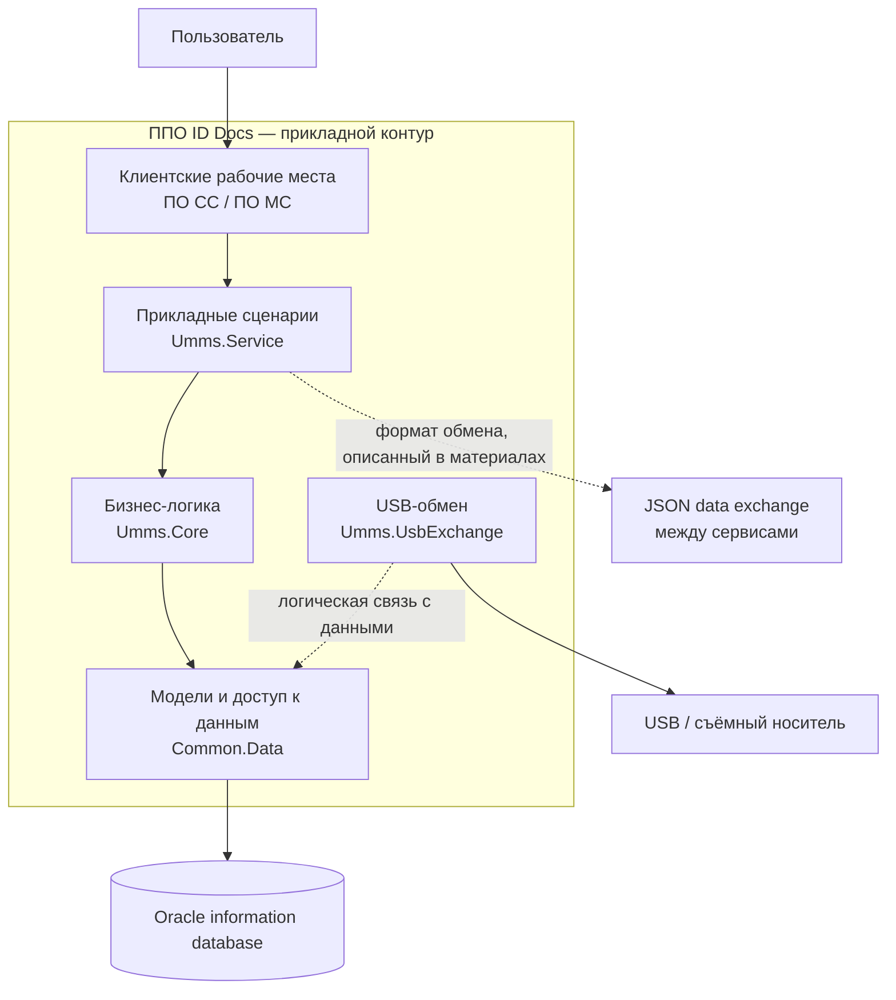
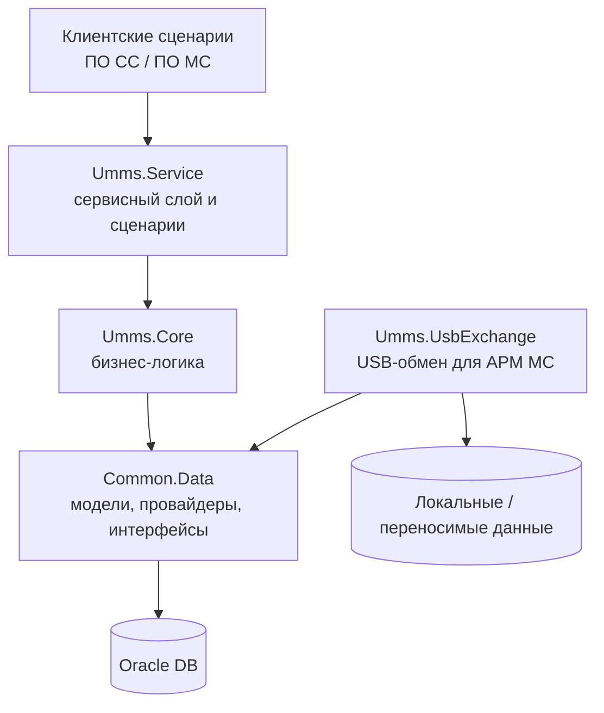
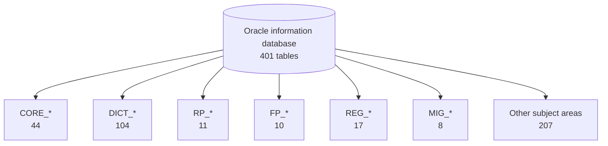
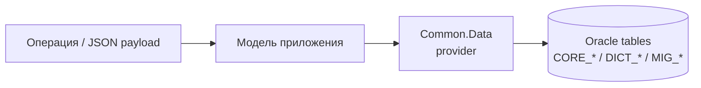

# Архитектурный обзор ППО ID Docs

[Главная документации](../) · [База данных и модели](../database/) · [Исходный код и модели](../source-code/) · [API и операции](../api/)

> **Статус документа:** логическая архитектурная модель, составленная по доступной проектной документации и выбранным материалам по исходному коду. Это не схема конкретной развёрнутой инсталляции и не результат проверки работающей production-среды.
>
> **Идентификация в портфолио:** Territory / Rexoft. В исходном комплекте технических материалов система обозначена как ППО ID Docs; это наименование сохранено в содержании документации.

## 1. Назначение и область рассмотрения

ППО ID Docs рассматривается как информационная система для учёта граждан, документов, дел, регистрационных и миграционных процессов. В рамках этого обзора документируются четыре взаимосвязанных архитектурных представления:

1. **Контекст и границы** — пользователи, прикладные компоненты, информационная база и документированные каналы обмена.
2. **Логические программные компоненты** — `Common.Data`, `Umms.Core`, `Umms.Service` и `Umms.UsbExchange`.
3. **Архитектура данных** — Oracle-модель, группы таблиц и ключевые предметные сущности.
4. **Операции и данные** — соответствие операций, моделей приложения и таблиц информационной базы.

Обзор не объединяет ППО ID Docs с ППО «Территория» ФМС, АРМ «Дешифратор», GLOBAL11 или другими самостоятельными проектами из портфолио.

## 2. Уровни доказательности

| Метка | Значение | Как используется |
|---|---|---|
| **Documented** | Сведения прямо указаны в доступных проектных материалах или документации репозитория | Можно описывать как документированный факт с указанием источника |
| **Source-observed** | Элемент или поведение обнаружены в просмотренных фрагментах исходного кода | Вывод ограничен просмотренными файлами и не распространяется автоматически на всю систему |
| **Logical view** | Схема связывает документированные компоненты для объяснения архитектуры | Показывает логическую структуру, но не подтверждает физическую топологию или runtime |
| **Unverified** | Данных недостаточно для подтверждения | Не представляется как установленный факт |

## 3. Контекст системы и границы

В материалах описаны клиентские рабочие места, прикладные компоненты, Oracle-информационная база и обмен данными. Следующая схема — логическое представление границ, а не схема размещения серверов.

**Что подтверждено материалами:** перечислены программные проекты `Common.Data`, `Umms.Core`, `Umms.Service`, `Umms.UsbExchange`; описаны рабочие места ПО СС / ПО МС, Oracle, JSON-обмен между сервисами и прямые SQL-запросы при работе АРМ МС.

**Что схема не утверждает:** точное число процессов и серверов, размещение компонентов, сетевую топологию, протоколы между всеми парами компонентов, границы транзакций, доступность сервисов и актуальную конфигурацию конкретной инсталляции.

## 4. Логическая архитектура программных компонентов

Ниже показаны роли компонентов по описанию структуры исходного кода. Направления связей обозначают логическую зависимость, а не доказанный сетевой вызов или физическое размещение.

### Роли компонентов

| Компонент | Документированная роль |
|---|---|
| `Common.Data` | Общие модели данных, провайдеры и интерфейсы доступа к данным |
| `Umms.Core` | Основная бизнес-логика |
| `Umms.Service` | Сервисный слой и реализация сценариев |
| `Umms.UsbExchange` | Обмен данными по USB для мобильного рабочего места |

Сопоставление моделей и провайдеров приведено в разделе [Исходный код и модели](../source-code/). Схема не означает, что каждый модуль использует все перечисленные компоненты или что все зависимости подтверждены анализом полного исходного дерева.

## 5. Архитектура данных Oracle

Документация информационной базы указывает **401 таблицу**. Распределение по префиксам приведено ниже.

| Группа | Назначение | Количество |
|---|---|---:|
| `CORE_*` | Общие сущности: лица, документы, дела, адреса и платежи | 44 |
| `DICT_*` | Справочные данные | 104 |
| `RP_*` | Российский паспорт | 11 |
| `FP_*` | Заграничный паспорт | 10 |
| `REG_*` | Регистрационный учёт | 17 |
| `MIG_*` | Миграционный учёт | 8 |
| Прочие | Другие предметные области | 207 |
| **Всего** | | **401** |

### Ключевые предметные сущности

- **Person:** `CORE_PERSON`, `CORE_PERSONDATA`, `CORE_PERSONSTATE`, `CORE_CITIZENSHIP`.
- **Documents:** `CORE_DOCUMENT` и связанные таблицы документов.
- **Cases:** `CORE_CASE`, `CORE_PERSON_CASE` и связанные сущности дел.
- **Addresses:** `CORE_ADDRESS`, `CORE_PERSON_ADDRESS`.
- **Reference data:** таблицы `DICT_*`, включая типы документов и страны.

Это обзор предметных групп, а не полная ER-модель с восстановленными кардинальностями. Детализация таблиц, полей и связей находится в [разделе базы данных](../database/).

### Примечание о числе таблиц

В отдельном документе физической структуры перечислены **381 пронумерованная позиция**. Это другой документальный источник. Значения 401 и 381 не объединяются и не трактуются как доказательство ошибки или изменения версии базы без сверки редакций, состава схем и методики подсчёта.

## 6. Операции и соответствие API — модели — БД

Документация репозитория описывает операции по лицам, документам, делам, справочникам и миграционному учёту. Для отдельных операций приведено сопоставление JSON-полей с моделями приложения и таблицами Oracle.

Примеры документированных соответствий:

| Область | Модель / провайдер | Таблицы |
|---|---|---|
| Персоны | `UmmsPersonModel` / `PersonProvider` | `CORE_PERSON`, `CORE_PERSONDATA`, `CORE_PERSON_ADDRESS` |
| Документы | `UmmsDocumentModel` / `DocumentProvider` | `CORE_DOCUMENT`, `DICT_DOCUMENT_TYPE` |
| Дела | `UmmsCaseModel` / `CaseProvider` | `CORE_CASE`, `CORE_PERSON_CASE`, `CORE_CASE_STATUS` |
| Адреса | `UmmsAddressModel` / `AddressProvider` | `CORE_ADDRESS`, `CORE_PERSON_ADDRESS`, справочники регионов и городов |
| Страны | `CountryModel` / `CountryProvider` | `DICT_COUNTRY` |

В материалах также отмечено, что клиент использует локальный `dict_country.csv` для справочника стран, хотя таблица `DICT_COUNTRY` присутствует в БД. Это различие сохранено в документации и не скрывается за упрощённой схемой.

**Ограничение:** опубликованный каталог операций и сопоставление полей — документационный анализ. Он сам по себе не доказывает наличие доступного HTTP-сервиса с указанными маршрутами, успешный вызов endpoint или выполнение операций в работающей среде. Подробности см. в [API и операциях](../api/).

## 7. Границы и вопросы, требующие отдельной проверки

| Вопрос | Текущий статус |
|---|---|
| Физическое размещение приложений и БД | Не подтверждено схемой deployment |
| Полная карта сетевых вызовов между компонентами | Требует исходников, конфигураций и/или трассировки |
| Полнота списка API-операций и их соответствие runtime-маршрутам | Требует сверки с реализацией и контрактами |
| Полная ER-модель с кардинальностями и ограничениями | Требует сверки с DDL или схемой БД |
| Фактическое выполнение SQL/JSON-сценариев в production | Не заявляется |
| Согласование перечней 401 и 381 | Требует сравнения исходных редакций документов |

## 8. Что подтверждает этот архитектурный кейс в портфолио

Этот комплект материалов демонстрирует:

- структурирование архитектуры корпоративной информационной системы по логическим уровням;
- документирование Oracle-модели и классификацию 401 таблицы по предметным группам;
- описание связей программных компонентов, моделей данных и провайдеров;
- анализ соответствия операций и JSON-полей структуре базы данных;
- подготовку Mermaid-схем и связанных Markdown-разделов в Docs-as-Code-репозитории.

Он **не заявляет** о проведении полного аудита production-системы, тестировании работающей инсталляции, восстановлении всей физической топологии или подтверждении всех интеграций.

## Связанные разделы

- [База данных и модели](../database/)
- [Исходный код и модели](../source-code/)
- [API и операции](../api/)
- [Главная документации](../)
