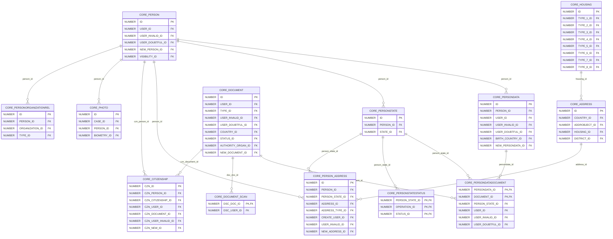
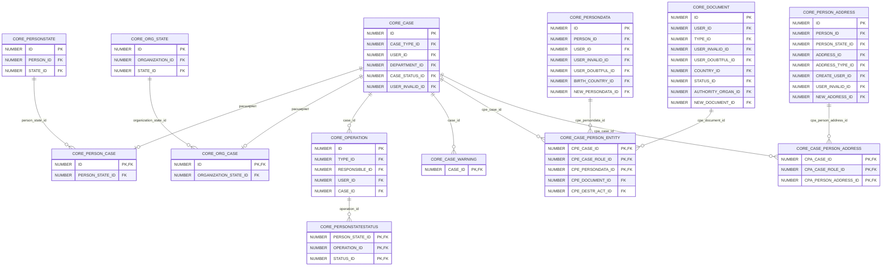
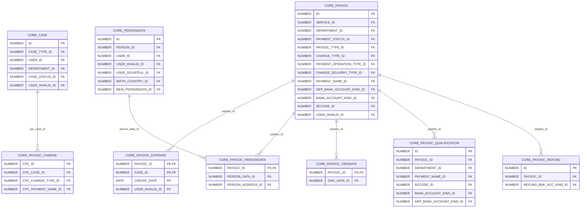
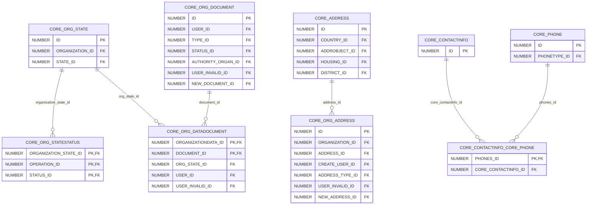
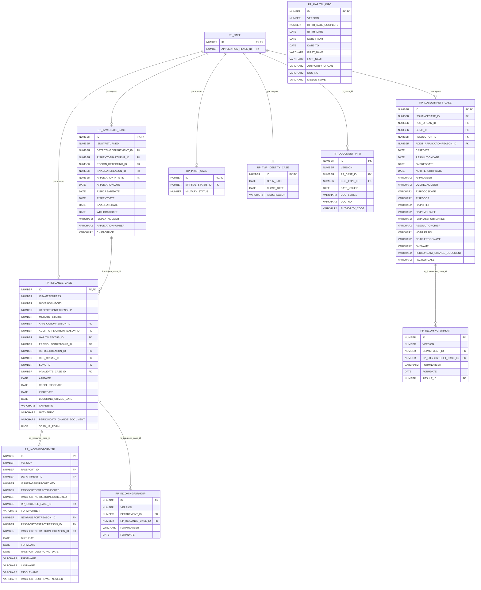
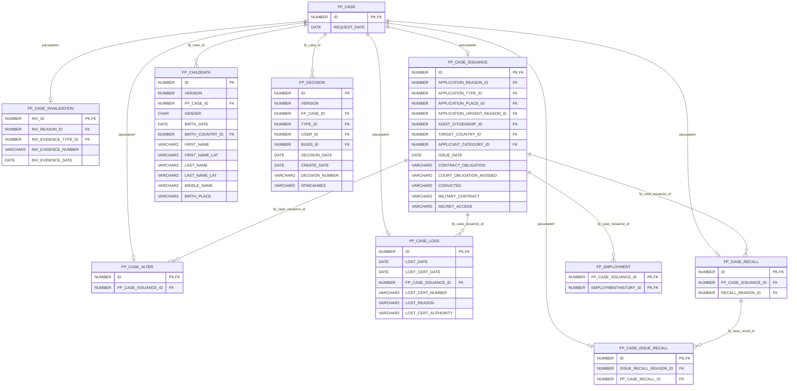

```mermaid
erDiagram
    REG_CASE ||--o| REG_CASE_CORELIVINGPLACE : "расширяет"
    REG_CASE ||--o| REG_CASE_RESIDENCE : "расширяет"
    REG_CASE_CORELIVINGPLACE ||--o| REG_CASE_RLIVINGPLACE : "расширяет"
    REG_CASE_CORELIVINGPLACE ||--o| REG_CASE_UNRLIVINGPLACE : "расширяет"
    REG_CASE_RESIDENCE ||--o| REG_CASE_RORGPLACE : "расширяет"
    REG_CASE_RESIDENCE ||--o| REG_CASE_RSANATORIUMPLACE : "расширяет"
    REG_CASE_RESIDENCE ||--o| REG_CASE_RSTAYINGPLACE : "расширяет"
    REG_CASE_RESIDENCE ||--o| REG_CASE_UNRSTAYINGPLACE : "расширяет"
    REG_RESIDENCERENTER ||--o{ REG_CASE_RLIVINGPLACE : "residencerenter_id"
    REG_RESIDENCERENTER ||--o{ REG_CASE_RSTAYINGPLACE : "residencerenter_id"
    REG_STATSHEET ||--o{ REG_CASE_CORELIVINGPLACE : "statsheet_id"
    REG_STATSHEET ||--o{ REG_CASE_RSTAYINGPLACE : "statsheet_id"
    REG_AS {
        NUMBER AS_ID PK, FK
        DATE AS_REG_DATE
        DATE AS_CREATE_DATE
        VARCHAR2 AS_CREATE_INSPECTOR
        VARCHAR2 AS_REG_INSPECTOR
    }
    REG_CASE {
        NUMBER ID PK, FK
        NUMBER DOC_BASIS_TYPE_ID FK
        NUMBER CAUSE_TYPE_ID FK
        DATE REG_SERVICE_DATE
        DATE REG_DATE_FROM
        DATE LAST_LIVADDR_DATE_FROM
        DATE LAST_LIVADDR_DATE_TO
    }
    REG_CASE_CORELIVINGPLACE {
        NUMBER ID PK, FK
        NUMBER ONCONTROL
        NUMBER STATSHEET_ID FK
        NUMBER SONO_ID FK
        NUMBER ARRIVAL_PLACE_ID FK
    }
    REG_CASE_RESIDENCE {
        NUMBER ID PK, FK
        NUMBER REG_TYPE_ID FK
        DATE APPLICATIONFILLINGDATE
        VARCHAR2 LOCALADMINISTRATIONDIVISION
    }
    REG_CASE_RLIVINGPLACE {
        NUMBER ID PK, FK
        NUMBER RESIDENCERENTER_ID FK
        NUMBER RESTRICTREGCAUSE_ID FK
        NUMBER CHANGED_CASE_ID FK
    }
    REG_CASE_RORGPLACE {
        NUMBER ID PK, FK
        NUMBER ON_TREATMENT_TERM
        NUMBER MEDICAL_INSTITUTION_ID FK
        DATE REG_DATE_TO
        NUMBER ASSOCIATED_CASE_ID FK
    }
    REG_CASE_RSANATORIUMPLACE {
        NUMBER ID PK, FK
        NUMBER SANATORIUM_ID FK
        DATE REGISTER_TO
        NUMBER ASSOCIATED_CASE_ID FK
    }
    REG_CASE_RSTAYINGPLACE {
        NUMBER ID PK, FK
        NUMBER VAGABOND
        DATE REG_DATE_TO
        DATE DATEREGISTRATION
        NUMBER RESIDENCERENTER_ID FK
        NUMBER STATSHEET_ID FK
        NUMBER RESTRICTREGCAUSE_ID FK
    }
    REG_CASE_UNRLIVINGPLACE {
        NUMBER ID PK, FK
        NUMBER SUBSTITUTEREPRESENTATIVEDATA
        DATE REGISTERTO
        DATE RECEPTIONDATE
        DATE UNREGISTRATIONCREATEDATE
        DATE ALUDEPARTUREDATE
        NUMBER REMOVALINQUIRYDEPARTMENT_ID FK
        NUMBER RESTRICTUNREGCAUSE_ID FK
        NUMBER PERSONTYPE_ID FK
        NUMBER ASSOCIATED_CASE_ID FK
    }
    REG_CASE_UNRSTAYINGPLACE {
        NUMBER ID PK, FK
        NUMBER SUBSTITUTEREPRESENTATIVEDATA
        NUMBER VAGABOND
        DATE REG_DATE_TO
        NUMBER DEREGISTRATIONCAUSE_ID FK
        NUMBER RESTRICTUNREGCAUSE_ID FK
        NUMBER ASSOCIATED_CASE_ID FK
    }
    REG_DECISION {
        NUMBER DEC_ID PK, FK
        NUMBER DEC_DUPLICATE
        DATE DEC_DATE
        NUMBER DEC_BASIS_TYPE_ID FK
        VARCHAR2 DEC_NUMBER
        VARCHAR2 DEC_ОПИСАНИЕ
    }
    REG_MILSERVICE {
        NUMBER MIL_ID PK, FK
        NUMBER MIL_COMM_ID FK
        NUMBER MIL_USER_ID FK
        DATE MIL_REG_DATE
        VARCHAR2 MIL_REG_NUMBER
    }
    REG_NOTICE_FORM_14 {
        NUMBER NOTICE_ID PK, FK
        NUMBER NOTICE_DIVISION_ID FK
        DATE NOTICE_CREATION_DATE
        DATE NOTICE_UNREGISTRATION_DATE
        VARCHAR2 NOTICE_INSPECTOR
    }
    REG_RESIDENCERENTER {
        NUMBER ID PK
        NUMBER VERSION
        NUMBER RESIDENCERENTERTYPE
        NUMBER DECISION_TYPE_ID FK
        DATE DECISION_DATE
        VARCHAR2 DECISION_NUMBER
        VARCHAR2 ORGANIZATION
    }
    REG_STATSHEET {
        NUMBER ID PK
        NUMBER VERSION
        NUMBER ACTIVITY_ID FK
        NUMBER ACTIVITYSTATUS_ID FK
        NUMBER EDUCATIONLEVEL_ID FK
        NUMBER FAMILYRELOCATIONSTATE_ID FK
        NUMBER FAMILYRELOCATIONTYPE_ID FK
        NUMBER STATSHEETREASON_ID FK
        NUMBER MARITALSTATUS_ID FK
        NUMBER PREVIOUS_CITIZENSHIP_ID FK
        NUMBER SECOND_CITIZENSHIP_ID FK
        NUMBER RELOCATIONREASON_ID FK
        NUMBER SOCIALPROVISIONTYPE_ID FK
        DATE LIVING_FROM_DATE
    }
    REG_UNREGRES {
        NUMBER RESIDENCE_ID PK, FK
        NUMBER RESIDENCE_DIVISION_ID FK
        DATE RESIDENCE_DEPARTURE_DATE
        VARCHAR2 RESIDENCE_INSPECTOR
        VARCHAR2 RESIDENCE_INSPECTOR_POST
    }
    REG_UNREG_WITHOUT_PERSON {
        NUMBER UWP_ID PK, FK
        NUMBER UWP_CAUSE_ID FK
        DATE UWP_CREATE_DATE
        DATE UWP_EFFECTIVE_DATE
        VARCHAR2 UWP_BASIS_NUMBER
        VARCHAR2 UWP_BASIS_NAME
        VARCHAR2 UWP_ORGAN_NAME
    }
```

```mermaid
erDiagram
    MIG_CASE_LIVINGADDRESS {
        NUMBER ID PK, FK
        DATE RECEPTION_DATE
        VARCHAR2 DOCNO
        NUMBER SONO_ID FK
        NUMBER PROVIDINGBASIS_ID FK
        NUMBER REASON_ID FK
        DATE REG_DATE_FROM
        DATE REG_DATE_TO
    }
    MIG_CASE_LIVING_DEREGISTR {
        NUMBER ID PK, FK
        NUMBER CASE_ID FK
        NUMBER REMOVAL_REASON_ID FK
        DATE REMOVAL_DATE
    }
    MIG_CASE_STAYINGPLACE {
        NUMBER ID PK, FK
        NUMBER LIMITED_REQUIRED_FIELDS
        NUMBER PROGRAMPARTICIPANT_ID FK
        DATE RECEPTION_DATE
        NUMBER SONO_ID FK
        NUMBER MIGRATIONCARD_ID FK
        NUMBER ARRIVALTYPE_ID FK
        NUMBER ENTRYGOAL_ID FK
        NUMBER DECLARANT_CONTACTINFO_ID FK
        NUMBER RECEIVER_CONTACTINFO_ID FK
        NUMBER PROLONGATION_REASON_ID FK
        DATE REG_DATE_FROM
        DATE REG_DATE_TO
        VARCHAR2 POST_NUMBER
    }
    MIG_CASE_STAYING_DEREGISTR {
        NUMBER ID PK, FK
        NUMBER CASE_ID FK
        NUMBER REMOVAL_REASON_ID FK
        DATE DEREGISTRATION_DATE
        VARCHAR2 RETURN_REASON
    }
    MIG_DEATH_CASE {
        NUMBER ID PK, FK
        DATE DEATH_DATE
        DATE EVIDENCE_ISSUANCE_DATE
        VARCHAR2 EVIDENCE_NUMBER
    }
    MIG_DWELLINGDOC {
        NUMBER ID PK, FK
        DATE DECISION_DATE
        VARCHAR2 DECISION_NUMBER
    }
    MIG_LABOURMIGDATA {
        NUMBER ID PK
        NUMBER VERSION
        NUMBER ISPATENT
        NUMBER ISSUEDWORDPERMITION
        NUMBER ANNULEDWORKPERMITION
        CHAR GENDER
        NUMBER DOCUMENTTYPE_ID FK
        DATE BIRTHDATE
        DATE DOCUMENTISSUEDATE
        DATE PERMITIONISSUEDDATE
        DATE PERMITIONVALIDTO
        DATE PERMITIONANNULEDDATE
        VARCHAR2 CITIZENSHIPALPHACODE
        VARCHAR2 DOCUMENTSERIES
        VARCHAR2 DOCUMENTNUMBER
        VARCHAR2 PERMITIONSERIES
        VARCHAR2 PERMITIONNUMBER
        VARCHAR2 PERMITIONEFFECTIVETERRITORY
        VARCHAR2 FIRSTNAME
        VARCHAR2 MIDDLENAME
        VARCHAR2 LASTNAME
    }
    MIG_UNREG_DATA {
        NUMBER ID PK
        NUMBER VERSION
        CHAR GENDER
        NUMBER DOCUMENTTYPE_ID FK
        NUMBER REMOVALREASON_ID FK
        NUMBER DEPARTURE_KPP_ID FK
        NUMBER CITIZENSHIP_ID FK
        NUMBER COUNTRY_ID FK
        DATE BIRTH_DATE
        DATE ENTRY_DATE
        DATE DEPARTURE_DATE
        VARCHAR2 DOCUMENTSERIES
        VARCHAR2 DOCUMENTNUMBER
        VARCHAR2 LAST_NAME
        VARCHAR2 FIRST_NAME
        VARCHAR2 MIDDLE_NAME
        VARCHAR2 NOTICENUMBER
        VARCHAR2 FILENAME
    }
```

# База данных и модели

## Обзор

Информационная база системы паспортного учёта (ППО «Территория»). Хранит данные о гражданах, документах, регистрации и миграции.

Модель реализована в Oracle и насчитывает 401 таблицу. Данные ядра хранятся в 44 таблицах `CORE_*`, значения справочников в 104 таблицах `DICT_*`, остальные таблицы относятся к модулям предметной области.

Источники: «Описание информационной базы. Логическая структура» и «Описание организации информационной базы».

## Структура модели

Таблицы называются по схеме `<МОДУЛЬ>_<ОБЪЕКТ>`:

| Префикс | Содержимое | Таблиц |
|---|---|--:|
| `CORE_` | Ядро (физические и юридические лица, документы, дела, платежи) | 44 |
| `DICT_` | Справочники | 104 |
| `RP_` | Российский паспорт | 11 |
| `FP_` | Загранпаспорт | 10 |
| `REG_` | Регистрационный учёт | 17 |
| `MIG_` | Миграционный учёт | 8 |
| прочие | остальные модули (гражданство, приглашения, визы, убежище, трудовая миграция и др.) | 207 |

## Ядро

Ядро хранит сущности, общие для всех модулей. Базовая идея модели: физическое лицо (`CORE_PERSON`) не имеет собственных атрибутов предметной области. Установочные данные (`CORE_PERSONDATA`), адреса, гражданство и состояния привязаны к нему отдельными записями, а большинство атрибутов имеет временной характер. Любая услуга оформляется как дело (`CORE_CASE`), а конкретные типы дел расширяют его в таблицах модулей.

### Таблицы ядра по группам

**Физические лица**

| Таблица | Назначение |
|---|---|
| `CORE_PERSON` | Физическое лицо. |
| `CORE_PERSONDATA` | Установочные (идентификационные) данные лица. |
| `CORE_PERSONDATADOCUMENT` | Сущность, связывающая конкретный документ с установочными данными и граждантсвом. |
| `CORE_PERSONSTATE` | Состояние физического лица |
| `CORE_PERSONSTATESTATUS` | Статус состояния физического лица по отношению к ФМС |
| `CORE_PERSON_ADDRESS` | Адрес физического лица |
| `CORE_PERSONORGANIZATIONREL` | Связь физического лица и юридического лица |
| `CORE_CITIZENSHIP` | Гражданство физического лица |
| `CORE_PHOTO` | Фотографии физических лиц |

**Документы**

| Таблица | Назначение |
|---|---|
| `CORE_DOCUMENT` | Документ. |
| `CORE_DOCUMENT_SCAN` | Сканированное изображение документа |
| `CORE_DOCUMENT_DESTRUCTION` | Акт об уничтожении документов |

**Адреса и контакты**

| Таблица | Назначение |
|---|---|
| `CORE_ADDRESS` | Адрес |
| `CORE_HOUSING` | Сводные значения для жилого помещения. |
| `CORE_CONTACTINFO` | Контактная информация. Включает в себя e-mail и список телефонов. |
| `CORE_CONTACTINFO_CORE_PHONE` | Список телефонов, актуальных для данного заявления |
| `CORE_PHONE` | Телефон. |

**Дела и операции**

| Таблица | Назначение |
|---|---|
| `CORE_CASE` | Базовый класс, представляющий дело о предоставлении услуги |
| `CORE_PERSON_CASE` | Класс, представляющий дело о предоставлении услуги физическим лицам |
| `CORE_ORG_CASE` | Базовая таблица для дел о предоставлении услуги юридическим лица. |
| `CORE_CASE_WARNING` | Предупреждения, сигналы которые могут возникать при создании дела |
| `CORE_CASE_PERSON_ENTITY` | Основные сущности дела |
| `CORE_CASE_PERSON_ADDRESS` | Адреса физических лиц, фигурирующие в деле |
| `CORE_CASE_PERSON_DELETED` | Удаленные сущности дела |
| `CORE_CASE_PERSON_ADRS_DELETED` | Удаленные из дел адреса физических лиц |
| `CORE_CASE_ORG_ENTITY` | Основные сущности дела для организации |
| `CORE_CASE_ORG_ADDRESS` | Адреса организаций, фигурирующие в деле |
| `CORE_CASE_ORG_DELETED` | Удаленные сущности дела юридического лица |
| `CORE_CASE_ORG_ADRS_DELETED` | Удаленные из дел адреса юридических лиц |
| `CORE_OPERATION` | Данные обо всех операциях системы. |
| `CORE_ORG_OPERATION` | Данные обо всех операциях системы, осуществляемых с делами о предоставлении услуг юридическому лицу. |

**Юридические лица**

| Таблица | Назначение |
|---|---|
| `CORE_ORG_STATE` | Состояние организации по отношению к ФМС. |
| `CORE_ORG_STATESTATUS` | Статус состояния организации в определённый момент времени. |
| `CORE_ORG_ADDRESS` | Адрес юридического лица |
| `CORE_ORG_DOCUMENT` | Документ, связанный с юридическим лицом. |
| `CORE_ORG_DATADOCUMENT` | Сущность, связывающая документ с юридическим лицом. |

**Платежи**

| Таблица | Назначение |
|---|---|
| `CORE_PAYDOC` | Платежный документ. |
| `CORE_PAYDOC_CHARGE` | Начисления за услуги ФМС |
| `CORE_PAYDOC_EXPENSE` | Расход по платежному поручительству. |
| `CORE_PAYDOC_ORGDATA` | Платежный документ юридического лица. |
| `CORE_PAYDOC_PERSONDATA` | Платежное поручительство физического лица. |
| `CORE_PAYDOC_QUALIFICATION` | Уточненные данные к платежному документу. |
| `CORE_PAYDOC_REFUND` | Возврат по платежному документу. |

**Служебные**

| Таблица | Назначение |
|---|---|
| `CORE_SEQUENCE` | Последовательные номера для обеспечения потребностей всех модулей системы |

### Основные таблицы

#### CORE_PERSON — физическое лицо

Физическое лицо.

| Поле | Тип | PK | FK | Обяз. | Описание |
|---|---|:-:|:-:|:-:|---|
| `ID` | NUMBER | ✓ |  | ✓ | Идентификатор. |
| `VERSION` | NUMBER |  |  | ✓ | Реализация оптимистической блокировки |
| `INVALID` | NUMBER(1) |  |  | ✓ | Данные корректны если 0 |
| `USER_ID` | NUMBER |  | ✓ | ✓ | Пользователь, сделавший изменение |
| `CHANGE_DATE` | DATE |  |  | ✓ | Дата изменений |
| `INVALID_DATE` | DATE |  |  |  | Дата инвалидации записи |
| `DEATH_DATE` | DATE |  |  |  | Дата сметри. |
| `DOUBTFUL_DATE` | DATE |  |  |  | Дата установки сомнительности |
| `DOUBTFUL` | NUMBER(1) |  |  |  | Сомнительность данных: 0 - достоверные, 1 - сомнительные, null - нет причин сомневаться |
| `USER_INVALID_ID` | NUMBER |  | ✓ |  | Пользователь, инвалидировавший запись |
| `USER_DOUBTFUL_ID` | NUMBER |  | ✓ |  | Пользователь, установивший сомнительность |
| `NEW_PERSON_ID` | NUMBER |  | ✓ |  | Идентификатор новой записи |
| `VISIBILITY_ID` | NUMBER |  | ✓ |  | Область видимости лица при поиске. |

#### CORE_PERSONDATA — установочные данные лица

Установочные (идентификационные) данные лица.

| Поле | Тип | PK | FK | Обяз. | Описание |
|---|---|:-:|:-:|:-:|---|
| `ID` | NUMBER | ✓ |  | ✓ | Идентификатор. |
| `VERSION` | NUMBER |  |  | ✓ | Реализация оптимистической блокировки |
| `PERSON_ID` | NUMBER |  | ✓ | ✓ | Ссылка на Лицо. |
| `BIRTH_DATE_COMPLETE` | NUMBER(1) |  |  | ✓ | Полнота даты рождения: 0 - отсутствует, 1 - год, 2 - год и месяц, 3 - полная дата |
| `INVALID` | NUMBER(1) |  |  | ✓ | Данные корректны если 0 |
| `USER_ID` | NUMBER |  | ✓ | ✓ | Пользователь, сделавший изменение |
| `GENDER` | CHAR(1) |  |  |  | Пол. |
| `FIRST_NAME` | VARCHAR2(100) |  |  | ✓ | FIRST_NAME. В случае если FIRST_NAME отсутствует должна использоваться константа [ОТСУТСТВУЕТ]. |
| `LAST_NAME` | VARCHAR2(200) |  |  | ✓ | LAST_NAME. В случае если LAST_NAME отсутствует должна использоваться константа [ОТСУТСТВУЕТ]. |
| `CHANGE_DATE` | DATE |  |  | ✓ | Дата изменений |
| `BIRTH_DATE` | DATE |  |  |  | Дата рождения. |
| `DATE_FROM` | DATE |  |  |  | Начало действия данных |
| `DATE_TO` | DATE |  |  |  | Окончание действия данных |
| `INVALID_DATE` | DATE |  |  |  | Дата инвалидации записи |
| `DOUBTFUL_DATE` | DATE |  |  |  | Дата установки сомнительности |
| `DOUBTFUL` | NUMBER(1) |  |  |  | Сомнительность данных: 0 - достоверные, 1 - сомнительные, null - нет причин сомневаться |
| `USER_INVALID_ID` | NUMBER |  | ✓ |  | Пользователь, инвалидировавший запись |
| `USER_DOUBTFUL_ID` | NUMBER |  | ✓ |  | Пользователь, установивший сомнительность |
| `BIRTH_COUNTRY_ID` | NUMBER |  | ✓ |  | Страна рождения. |
| `NEW_PERSONDATA_ID` | NUMBER |  | ✓ |  | Указатель на корректные данные |
| `MIDDLE_NAME` | VARCHAR2(100) |  |  |  | Отчество. |
| `FIRST_NAME_LAT` | VARCHAR2(100) |  |  |  | FIRST_NAME на латинице. |
| `MIDDLE_NAME_LAT` | VARCHAR2(100) |  |  |  | Отчество на латинице. |
| `LAST_NAME_LAT` | VARCHAR2(200) |  |  |  | LAST_NAME на латинице. |
| `BIRTH_PLACE_1` | VARCHAR2(200) |  |  |  | Место рождения. Основная часть или регион |
| `BIRTH_PLACE_2` | VARCHAR2(200) |  |  |  | Место рождения. Если заполнено - район |
| `BIRTH_PLACE_3` | VARCHAR2(200) |  |  |  | Место рождения. Если заполнено - город |
| `BIRTH_PLACE_4` | VARCHAR2(200) |  |  |  | Место рождения. Если заполнено - населенный пункт |
| `FIO_RUS` | VARCHAR2(400) |  |  |  | LAST_NAME, FIRST_NAME, отчество кириллицей |
| `FIO_LAT` | VARCHAR2(400) |  |  |  | LAST_NAME, FIRST_NAME, отчество латиницей |
| `FIO_RUS_METAPHONE` | VARCHAR2(400) |  |  |  | Метафон от фамилии, имени и отчества кириллицей |

#### CORE_DOCUMENT — документ

Документ.

| Поле | Тип | PK | FK | Обяз. | Описание |
|---|---|:-:|:-:|:-:|---|
| `ID` | NUMBER | ✓ |  | ✓ | Идентификатор. |
| `VERSION` | NUMBER |  |  | ✓ | Реализация оптимистической блокировки |
| `INVALID` | NUMBER(1) |  |  | ✓ | Данные корректны если 0 |
| `USER_ID` | NUMBER |  | ✓ | ✓ | Пользователь, сделавший изменение |
| `TYPE_ID` | NUMBER |  | ✓ | ✓ | Тип документа. |
| `CHANGE_DATE` | DATE |  |  | ✓ | Дата изменений |
| `DOCNO` | VARCHAR2(50) |  |  | ✓ | Номер. |
| `DOCNO_HASH` | VARCHAR2(50) |  |  | ✓ | Хэш номера |
| `SERIES` | VARCHAR2(30) |  |  |  | Серия. |
| `SERIES_HASH` | VARCHAR2(30) |  |  |  | Хэш серии документа |
| `DATE_ISSUED` | DATE |  |  |  | Дата выдачи. |
| `EXTEND_TO` | DATE |  |  |  | Продлен до. |
| `VALID_FROM` | DATE |  |  |  | Действителен с. |
| `VALID_TO` | DATE |  |  |  | Действителен по. |
| `DESTRUCTION_DATE` | DATE |  |  |  | Дата уничтожения документа |
| `INVALID_DATE` | DATE |  |  |  | Дата инвалидации записи |
| `DOUBTFUL_DATE` | DATE |  |  |  | Дата установки сомнительности |
| `DOUBTFUL` | NUMBER(1) |  |  |  | Сомнительность данных: 0 - достоверные, 1 - сомнительные, null - нет причин сомневаться |
| `USER_INVALID_ID` | NUMBER |  | ✓ |  | Пользователь, инвалидировавший запись |
| `USER_DOUBTFUL_ID` | NUMBER |  | ✓ |  | Пользователь, установивший сомнительность |
| `COUNTRY_ID` | NUMBER |  | ✓ |  | Страна выдачи. |
| `STATUS_ID` | NUMBER |  | ✓ | ✓ | Статус документа. |
| `AUTHORITY_ORGAN_ID` | NUMBER |  | ✓ |  | Орган, выдавший документ. |
| `NEW_DOCUMENT_ID` | NUMBER |  | ✓ |  | Идентификатор корректного документа |
| `AUTHORITY_CODE` | VARCHAR2(50) |  |  |  | Код выдавшего подразделения. |
| `SERIES_DOCNO_HASH` | VARCHAR2(80) |  |  |  | Хэш серии и номера документа |
| `SERIES_DOCNO_CONCAT` | VARCHAR2(100) |  |  |  | Конкатенация серии и номера документа |
| `AUTHORITY` | VARCHAR2(500) |  |  |  | Кем выдан. |

#### CORE_PERSONDATADOCUMENT — связь документа с установочными данными

Сущность, связывающая конкретный документ с установочными данными и граждантсвом.

| Поле | Тип | PK | FK | Обяз. | Описание |
|---|---|:-:|:-:|:-:|---|
| `PERSONDATA_ID` | NUMBER | ✓ | ✓ | ✓ | Установочные данные, которые связаны с документом. |
| `DOCUMENT_ID` | NUMBER | ✓ | ✓ | ✓ | Документ, связанный с установочными данными. |
| `PERSON_STATE_ID` | NUMBER |  | ✓ | ✓ | Состояние лица по отношению к ФМС. В общем случае появляется при обращении лица за оказанием услуги. |
| `IS_ENTERED` | NUMBER(1) |  |  | ✓ | Физическое лицо вписано в документ и не является его владельцем |
| `INVALID` | NUMBER(1) |  |  | ✓ | Данные корректны если 0 |
| `USER_ID` | NUMBER |  | ✓ | ✓ | Пользователь, сделавший изменение |
| `CHANGE_DATE` | DATE |  |  | ✓ | Дата изменений |
| `INVALID_DATE` | DATE |  |  |  | Пользователь, инвалидировавший запись |
| `DOUBTFUL_DATE` | DATE |  |  |  | Дата установки сомнительности |
| `DOUBTFUL` | NUMBER(1) |  |  |  | Сомнительность данных: 0 - достоверные, 1 - сомнительные, null - нет причин сомневаться |
| `USER_INVALID_ID` | NUMBER |  | ✓ |  | Дата инвалидации записи |
| `USER_DOUBTFUL_ID` | NUMBER |  | ✓ |  | Пользователь, установивший сомнительность |

#### CORE_CASE — дело

Базовый класс, представляющий дело о предоставлении услуги

| Поле | Тип | PK | FK | Обяз. | Описание |
|---|---|:-:|:-:|:-:|---|
| `ID` | NUMBER | ✓ |  | ✓ | Идентификатор |
| `VERSION` | NUMBER |  |  | ✓ | Реализация оптимистической блокировки |
| `INVALID` | NUMBER(1) |  |  | ✓ | Данные корректны, если 0 |
| `IN_CHECKLIST` | NUMBER(1) |  |  | ✓ | Заявитель находится в контрольном списке |
| `CASE_TYPE_ID` | NUMBER |  | ✓ | ✓ | Тип дела |
| `USER_ID` | NUMBER |  | ✓ | ✓ | Кем созданно |
| `DEPARTMENT_ID` | NUMBER |  | ✓ | ✓ | Подразделение в котором заводили дело |
| `CASE_STATUS_ID` | NUMBER |  | ✓ | ✓ | Статус дела |
| `CREATE_DATE` | DATE |  |  | ✓ | Дата создание |
| `INVALID_DATE` | DATE |  |  |  | Дата инвалидации дела |
| `USER_INVALID_ID` | NUMBER |  | ✓ |  | Пользователь, инвалидировавший дело |
| `CASE_NUMBER` | VARCHAR2(100) |  |  |  | Номер дела |
| `CASE_ARC_NUMBER` | VARCHAR2(100) |  |  |  | Архивный номер дела |
| `ОПИСАНИЕS` | VARCHAR2(4000) |  |  |  | Примечания |

## Связи

Связи выведены по именам полей: у `CORE_PERSONDATA` есть FK `PERSON_ID`, поэтому она ссылается на `CORE_PERSON`. В исходном документе целевые таблицы ключей не указаны. Ссылки на справочники `DICT_*` и таблицы других модулей не показаны, на диаграммах только первичные и внешние ключи.

### Физические лица, документы и адреса

### Дела и операции

### Платежи

### Юридические лица

Связь «расширяет» означает, что `ID` дочерней таблицы одновременно PK и FK: `CORE_PERSON_CASE` и `CORE_ORG_CASE` дополняют `CORE_CASE` для дел физических и юридических лиц.

## Справочники (DICT_*)

В модели 104 справочных таблиц.

Полный список справочников

| Таблица | Назначение |
|---|---|
| `DICT_ACADEMICDEGREE` | Справочник: ученая степень. |
| `DICT_ACADEMICTITLE` | Справочник: ученое звание. |
| `DICT_ACTIVITYKIND` | Справочник видов деятельности. |
| `DICT_ADDRESS_OBJECT` | Справочник адресных объектов |
| `DICT_ADDRESS_OBJECT_TYPE` | Справочник типов адресных объектов |
| `DICT_ADDRESS_TYPE` | Справочник типов адресов |
| `DICT_ADMPRACTICE_ARTICLE` | Справочник "Статья КоАП РФ" для "Админ. Практики". Необходим на время, сольется с AdmArticle. |
| `DICT_ADM_ARTICLE` | Справочник "Статья КоАП". |
| `DICT_ADM_DISCIPLINE` | Справочник значений административного взыскания. |
| `DICT_ADM_OFFENCETYPE` | Справочник "Тип административного правонарушения". |
| `DICT_ATTR` | Связь виртуального справочника со значениями реальных справочников |
| `DICT_BANKACCOUNTKIND` | Тип банковского счёта. |
| `DICT_BCCODE` | Справочник кодов бюджетной классификации. |
| `DICT_BIOMETRYBASIS` | Справочник оснований биометрии |
| `DICT_BLANKRESTRICTION` | Ограничение на использование серии бланка в регионе. |
| `DICT_CAPITALKIND` | Вид уставного капитала. |
| `DICT_CASETYPE` | Справочник всех типов дел по государственным услугам оказываемым ФМС России. |
| `DICT_CASE_ROLE` | Справочник ролей, участвующих в делах |
| `DICT_CASE_STATUS` | Справочник состояний дел |
| `DICT_CHRG_BASIS` | Основание платежа. |
| `DICT_CHRG_DELIVERY_TYPE` | Способ расчетов между банком (филиалом) плательщика и банком (филиалом) получателя платежа. |
| `DICT_CIT` | Комплексный справочник модуля "Гражданство" |
| `DICT_CITIZENSHIP` | Справочник: Гражданство. |
| `DICT_CIT_BASIS` | Основания для рассмотрения вопросов гражданства. |
| `DICT_COMMON` | Общий справочник функциональных модулей |
| `DICT_CONVICTIONTYPE` | Справочник: судимость. |
| `DICT_COUNTRY` | Справочник стран |
| `DICT_DECISIONBASIS` | Основание решения (справочник). |
| `DICT_DECISIONTYPE` | Справочник типов решений. |
| `DICT_DESTRUCTION_ACT_TYPE` | Справочник типов актов на уничтожение документов |
| `DICT_DISTRICT` | Справочник городских районов |
| `DICT_DOCSTATUS` | Статус документа. |
| `DICT_DOCUMENTTYPE` | Справочник типов документов. |
| `DICT_DOCUMENT_OPTION` | Опции документа. Информация о масках на ввод, прапвилах валидации, обязательности полей. |
| `DICT_DWELLINGPROVIDINGBASIS` | Справочник оснований предоставления помещения. |
| `DICT_DWELLINGPROVIDINGREASON` | Причина предоставления жилого помещения. |
| `DICT_EDUCATIONLEVEL` | Справочник: Уровень образования. |
| `DICT_ENTITY` | Справочник сущностей приложения |
| `DICT_ENTITY_ATTRIBUTE` | Справочник атрибутов сущностей |
| `DICT_ENTRYGOAL` | Справочник: Цель въезда. |
| `DICT_FORM5_STATUS` | Справочник состояний загружаемой из внешних систем формы 5 |
| `DICT_FRGU_PROCEDURE` | Справочник процедур ФРГУ |
| `DICT_FUNDS_SOURCE` | Справочник "Источник средств". |
| `DICT_ICHG_CONFIGPARAM` | Справочник имен параметров конфигураций для внешнего взаимодействия |
| `DICT_ICHG_INTERCHANGE_TYPE` | Справочник типов электронного взаимодействия |
| `DICT_ICHG_OSKREQUESTPURPOSE` | Справочник целей проверки, указываемых при запросе в ОСК |
| `DICT_ICHG_SYSTEMTYPE` | Справочник типов внешних систем, которым направляется запрос |
| `DICT_INFO` | Перечень справочников ФХД и их атрибуты |
| `DICT_JOB` | Справочник возможных типов фоновых задач |
| `DICT_JOB_PARAMETER` | Справочник параметров для типовых фоновых задач |
| `DICT_LANGUAGE` | Справочник: Язык. |
| `DICT_LANGUAGESKILL` | Справочник: Уровнь знания языка. |
| `DICT_MEDICALINSPECTIONRESULT` | Справочник: Анкетные данные/Медицинское обследование/Результаты обследования. |
| `DICT_MIG_REMOVALREASON` | Причина снятия с учета. |
| `DICT_MIG_STAYREMREASON` | Причина снятия с учета. |
| `DICT_MODULE` | Справочник модулей приложения. |
| `DICT_NATIONALITY` | Справочник: Национальность. |
| `DICT_NDS_RATE` | Ставка НДС (Без НДС, 10%, 18%) |
| `DICT_NOTICEFROM` | Справочник мест откуда получено уведомление. |
| `DICT_OCCUPATION` | Справочник: Занятость. |
| `DICT_OFFICIAL_ORGAN` | Справочник официальных органов. |
| `DICT_OKATO` | Справочник ОКАТО |
| `DICT_OPERATION` | Содержит список всех операций в системе в иерархии по типу дел. |
| `DICT_OPF` | Организационно-правовая форма. |
| `DICT_OPF2T` | Справочник ОПФ Т2. |
| `DICT_ORDER_OF_PAYMENT` | Очередность платежа. |
| `DICT_ORGASSOCIATION` | Справочник (торговых, экономических) Ассоциаций. |
| `DICT_ORGBRANCH` | Справочник отраслей. |
| `DICT_OWNERSHIP` | Справочник форм собственности. |
| `DICT_PAYERSTATUS` | Статус плательщика. |
| `DICT_PAYMENT_NAME` | Наименование платежа. |
| `DICT_PERMISSION` | Привилегия. |
| `DICT_PERSONORGANIZATION` | Справочник наименований отношения лица к организации. |
| `DICT_PERSONSTATE` | Справочник всех состояний лица по отношению к ФМС. |
| `DICT_PERSONSTATESTATUS` | Справочник статусов состояний лица. |
| `DICT_PHONETYPE` | Тип телефона. |
| `DICT_PORTALFMSSERVICE` | Сервис Портала ФМС. |
| `DICT_POSITION` | Справочник "Должность". |
| `DICT_PROFESSION` | Справочник профессий/должностей. |
| `DICT_PROFESSIONPREFIX` | Справочник префиксов видов деятельности. |
| `DICT_PROFESSION_GROUPS` | Справочник групп профессий(ОКЗ). |
| `DICT_RECEIVERTYPE` | Тип принимающей стороны. |
| `DICT_RELATIONSHIPDEGREE` | Справочник: Тип отношения ребенка к родителю. |
| `DICT_RELATIONTYPE` | Тип родственной связи. |
| `DICT_RELIGION` | Вероисповедание. |
| `DICT_SERVICE` | Справочник всех услуг оказываемых ФМС России. |
| `DICT_SIG` | Комплексный справочник модуля работы с сигналами |
| `DICT_SPECIALTY` | Специальность (образование). |
| `DICT_SPEC_STATUS` | Справочник "Особый статус". |
| `DICT_SX` | Справочник значений СК |
| `DICT_SX_CORRESPOND` | Справочник соответствия значений ППО значениям СК |
| `DICT_SX_REQUEST_TYPE` | Справочник типов запросов в сервисный концентратор |
| `DICT_TAT_CITY` | Справочник татарских наименований городов. |
| `DICT_TAT_COUNTRY` | Справочник татарских наименований стран. |
| `DICT_TAT_DEPARTMENT` | Справочник татарских наименований подразделений ФМС России. |
| `DICT_TAT_REGION` | Справочник татарских наименований регионов. |
| `DICT_TAT_ROOTNAME` | Справочник нациоанльных татарских отчеств. |
| `DICT_TAT_SUBREGION` | Справочник татарских наименований районов. |
| `DICT_TAT_NAME` | Справочник соответствий татарских и русских имен. |
| `DICT_TAX_PERIOD` | Налоговый период. |
| `DICT_TRANSPORT` | Справочник: транспорт. |
| `DICT_VISACATEGORY` | Категория и вид визы. |
| `DICT_VISAMULTIPLICITY` | Кратность визы. |
| `DICT_VISA_ISSUED_CITY` | Города, в которых могут выдавать визу РФ |

---

## Российский паспорт

Модуль автоматизирует оформление и выдачу паспортов граждан РФ: первоначальную выдачу, выдачу в связи с утратой (хищением), замену по основаниям, указанным в Положении о паспорте гражданина РФ (постановление Правительства РФ от 8 июля 1997 г. № 828).

Типы дел модуля:

- Дело по выдаче (замене) паспорта
- Дело об объявлении паспорта недействительным
- Дело об утрате (хищении) паспорта

Источник: раздел 2 «Российский паспорт» логической структуры ИБ и «Описание организации информационной базы». Таблиц в модуле: **11**.

### Таблицы

| Таблица | Назначение |
|---|---|
| [`RP_CASE`](#rp-case) | Базовая таблица дел модуля Российский паспорт |
| [`RP_DOCUMENT_INFO`](#rp-document-info) | Ранее выданные документы гражданина |
| [`RP_INCOMINGFORM22P`](#rp-incomingform22p) | Входящее сообщение Ф.№22П. |
| [`RP_INCOMINGFORM25P`](#rp-incomingform25p) | Для фиксации входящих сообщений, по форме №25П. |
| [`RP_INCOMINGFORM26P`](#rp-incomingform26p) | Для фиксации входящих ответов, по форме №26П. |
| [`RP_INVALIDATE_CASE`](#rp-invalidate-case) | Дело об обьявлении паспорта гражданина не действительным. |
| [`RP_ISSUANCE_CASE`](#rp-issuance-case) | Дело о выдаче/замене паспорта гражданина России. |
| [`RP_LOSSORTHEFT_CASE`](#rp-lossortheft-case) | Дело об утрате/хищении паспорта гражданина. |
| [`RP_MARITAL_INFO`](#rp-marital-info) | Информация о браке / разводе гражданина |
| [`RP_PRINT_CASE`](#rp-print-case) | Дело для допечатывания данных в РП. |
| [`RP_TMP_IDENTITY_CASE`](#rp-tmp-identity-case) | Журнал учета ВУЛ. |

### Связи

Связи на диаграмме выведены по именам полей (`<ТАБЛИЦА>_ID`); «расширяет» означает, что `ID` дочерней таблицы одновременно PK и FK, то есть таблица дополняет родительскую. Иерархия вложенности выведена по названиям и описаниям таблиц. В исходном документе целевые таблицы внешних ключей не указаны, поэтому ссылки на справочники `DICT_*` и таблицы ядра `CORE_*` здесь не нарисованы: они отмечены только признаком FK в списках полей.

### Описание таблиц

#### RP_CASE

Базовая таблица дел модуля Российский паспорт

| Поле | Тип | PK | FK | Обяз. | Описание |
|---|---|:-:|:-:|:-:|---|
| `ID` | NUMBER | ✓ | ✓ | ✓ | Идентификатор дела |
| `APPLICATION_PLACE_ID` | NUMBER |  | ✓ | ✓ | Тип места обращения |

#### RP_DOCUMENT_INFO

Ранее выданные документы гражданина

| Поле | Тип | PK | FK | Обяз. | Описание |
|---|---|:-:|:-:|:-:|---|
| `ID` | NUMBER | ✓ |  | ✓ | Идентификатор |
| `VERSION` | NUMBER |  |  | ✓ | Реализация оптимистической блокировки |
| `RP_CASE_ID` | NUMBER |  | ✓ | ✓ | Идентификатор дела для модуля Российский паспорт |
| `DOC_TYPE_ID` | NUMBER |  | ✓ | ✓ | Тип документа |
| `DATE_ISSUED` | DATE |  |  | ✓ | Дата выдачи |
| `DOC_SERIES` | VARCHAR2(30) |  |  | ✓ | Серия документа |
| `DOC_NO` | VARCHAR2(50) |  |  | ✓ | Номер документа |
| `AUTHORITY_CODE` | VARCHAR2(50) |  |  |  | Код подразделения |

#### RP_INCOMINGFORM22P

Входящее сообщение Ф.№22П.

| Поле | Тип | PK | FK | Обяз. | Описание |
|---|---|:-:|:-:|:-:|---|
| `ID` | NUMBER | ✓ |  | ✓ | Идентификатор. |
| `VERSION` | NUMBER |  |  | ✓ | Реализация оптимистической блокировки |
| `PASSPORT_ID` | NUMBER |  | ✓ | ✓ | Сообщение о паспорте. |
| `DEPARTMENT_ID` | NUMBER |  | ✓ | ✓ | Сообщающее подразделение. |
| `ISSUEPASSPORTCHECKED` | NUMBER(1) |  |  | ✓ | Выдан ли новый паспорт. |
| `PASSPORTDESTROYCHECKED` | NUMBER(1) |  |  | ✓ | Уничтожен ли паспорт. |
| `PASSPORTNOTRETURNEDCHECKED` | NUMBER(1) |  |  | ✓ | Сдан ли паспорт. |
| `RP_ISSUANCE_CASE_ID` | NUMBER |  | ✓ | ✓ | Дело о выдаче/замене паспорта |
| `FORMNUMBER` | VARCHAR2(100) |  |  | ✓ | Исходащий номер сообщения. |
| `NEWPASSPORTREASON_ID` | NUMBER |  | ✓ |  | Сообщение о причине выдачи паспорта. |
| `PASSPORTDESTROYREASON_ID` | NUMBER |  | ✓ |  | Причина уничтожения |
| `PASSPORTNOTRETURNEDREASON_ID` | NUMBER |  | ✓ |  | Причина, по которой пасспорт должен быть сдан, но не сдан |
| `BIRTHDAY` | DATE |  |  |  | Дата рождения гражданина. |
| `FORMDATE` | DATE |  |  |  | Дата сообщения. |
| `PASSPORTDESTROYACTDATE` | DATE |  |  |  | Дата акта об уничтожении. |
| `FIRSTNAME` | VARCHAR2(100) |  |  |  | FIRST_NAME гражданина. |
| `LASTNAME` | VARCHAR2(200) |  |  |  | LAST_NAME гражданина. |
| `MIDDLENAME` | VARCHAR2(100) |  |  |  | Отчество гражданина. |
| `PASSPORTDESTROYACTNUMBER` | VARCHAR2(100) |  |  |  | Номер акта об уничтожении. |

#### RP_INCOMINGFORM25P

Для фиксации входящих сообщений, по форме №25П.

| Поле | Тип | PK | FK | Обяз. | Описание |
|---|---|:-:|:-:|:-:|---|
| `ID` | NUMBER | ✓ |  | ✓ | Идентификатор. |
| `VERSION` | NUMBER |  |  | ✓ | Реализация оптимистической блокировки |
| `DEPARTMENT_ID` | NUMBER |  | ✓ | ✓ | Сообщающее подразделение. |
| `RP_ISSUANCE_CASE_ID` | NUMBER |  | ✓ | ✓ | Дело о выдаче/замене паспорта |
| `FORMNUMBER` | VARCHAR2(100) |  |  | ✓ | Исходящий номер сообщения. |
| `FORMDATE` | DATE |  |  |  | Дата сообщения. |

#### RP_INCOMINGFORM26P

Для фиксации входящих ответов, по форме №26П.

| Поле | Тип | PK | FK | Обяз. | Описание |
|---|---|:-:|:-:|:-:|---|
| `ID` | NUMBER | ✓ |  | ✓ | Идентификатор. |
| `VERSION` | NUMBER |  |  | ✓ | Реализация оптимистической блокировки |
| `DEPARTMENT_ID` | NUMBER |  | ✓ | ✓ | Сообщающее подразделение. |
| `RP_LOSSORTHEFT_CASE_ID` | NUMBER |  | ✓ | ✓ | Дело об утрате/хищении паспорта |
| `FORMNUMBER` | VARCHAR2(100) |  |  | ✓ | Исходящий номер сообщения. |
| `FORMDATE` | DATE |  |  |  | Дата сообщения. |
| `RESULT_ID` | NUMBER |  | ✓ |  | Заключение |

#### RP_INVALIDATE_CASE

Дело об обьявлении паспорта гражданина не действительным.

| Поле | Тип | PK | FK | Обяз. | Описание |
|---|---|:-:|:-:|:-:|---|
| `ID` | NUMBER | ✓ | ✓ | ✓ | Идентификатор |
| `ISNOTRETURNED` | NUMBER(1) |  |  | ✓ | Отмека о том, что паспорт не сдан. |
| `DETECTINGDEPARTMENT_ID` | NUMBER |  | ✓ |  | Подразделение, обнаружившее документ. |
| `F29PEXTDEPARTMENT_ID` | NUMBER |  | ✓ |  | Подразделение, уничтожившее паспорт. |
| `REGION_DETECTING_ID` | NUMBER |  | ✓ |  | Регион обнаружения документа. |
| `INVALIDATEREASON_ID` | NUMBER |  | ✓ |  | Причина обьявления паспорта недействительным |
| `APPLICATIONTYPE_ID` | NUMBER |  | ✓ |  | Тип заявления |
| `APPLICATIONDATE` | DATE |  |  |  | Дата заявления |
| `F22PCREATEDATE` | DATE |  |  |  | Дата подготовки Ф№22П. |
| `F29PEXTDATE` | DATE |  |  |  | Дата акта об уничтожении, в стороннем подразделении. |
| `INVALIDATEDATE` | DATE |  |  |  | Дата обьявления паспорта недействительным. |
| `WITHDRAWDATE` | DATE |  |  |  | Дата изъятия. |
| `F29PEXTNUMBER` | VARCHAR2(50) |  |  |  | Номер акта об уничтожении, в стороннем подразделении. |
| `APPLICATIONNUMBER` | VARCHAR2(100) |  |  |  | Входящий номер заявления |
| `CHIEFOFFICE` | VARCHAR2(200) |  |  |  | Начальник подразделения. |

#### RP_ISSUANCE_CASE

Дело о выдаче/замене паспорта гражданина России.

| Поле | Тип | PK | FK | Обяз. | Описание |
|---|---|:-:|:-:|:-:|---|
| `ID` | NUMBER | ✓ | ✓ | ✓ | Идентификатор |
| `ISSAMEADDRESS` | NUMBER(1) |  |  | ✓ | Адрес - откуда прибыл такой же как и адрес регистрации |
| `MOVEINSAMECITY` | NUMBER(1) |  |  | ✓ | Признак, что переехал в том же населенном пункте |
| `HADFOREIGNCITIZENSHIP` | NUMBER(1) |  |  | ✓ | Имел ли иностранное гражданство |
| `MILITARY_STATUS` | NUMBER(1) |  |  |  | Признак наличия воинской обязанности |
| `APPLICATIONREASON_ID` | NUMBER |  | ✓ |  | Причина открытия дела |
| `ADDIT_APPLICATIONREASON_ID` | NUMBER |  | ✓ |  | Дополнительная причина открытия дела |
| `MARITALSTATUS_ID` | NUMBER |  | ✓ |  | Семейное положение |
| `PREVIOUSCITIZENSHIP_ID` | NUMBER |  | ✓ |  | Страна предыдущего гражданства |
| `REFUSEDREASON_ID` | NUMBER |  | ✓ |  | Причина отказа в выдаче паспорта. |
| `REG_ORGAN_ID` | NUMBER |  | ✓ |  | Орган регистрационного учета, для штампа о регистрации. |
| `SONO_ID` | NUMBER |  | ✓ |  | Налоговый орган (СОНО), связанный с делом. |
| `INVALIDATE_CASE_ID` | NUMBER |  | ✓ |  | Дело об обьявлении паспорта не действительным |
| `APPDATE` | DATE |  |  |  | Дата заявления |
| `RESOLUTIONDATE` | DATE |  |  |  | Дата принятия решения. |
| `ISSUEDATE` | DATE |  |  |  | Дата фактической выдачи паспорта. |
| `BECOMING_CITIZEN_DATE` | DATE |  |  |  | Дата принятия гражданства РФ |
| `FATHERFIO` | VARCHAR2(200) |  |  |  | ФИО отца |
| `MOTHERFIO` | VARCHAR2(200) |  |  |  | ФИО матери |
| `PERSONDATA_CHANGE_DOCUMENT` | VARCHAR2(200) |  |  |  | Документ - основание для смены УД |
| `SCAN_1P_FORM` | BLOB |  |  |  | Сканированная копия формы 1П (заявления) |

#### RP_LOSSORTHEFT_CASE

Дело об утрате/хищении паспорта гражданина.

| Поле | Тип | PK | FK | Обяз. | Описание |
|---|---|:-:|:-:|:-:|---|
| `ID` | NUMBER | ✓ | ✓ | ✓ | Идентификатор |
| `ISSUANCECASE_ID` | NUMBER |  | ✓ |  | Дело о выдаче паспорта. |
| `REG_ORGAN_ID` | NUMBER |  | ✓ |  | Орган регистрационного учета, для штампа о регистрации |
| `SONO_ID` | NUMBER |  | ✓ |  | Налоговый орган (СОНО), связанный с делом |
| `RESOLUTION_ID` | NUMBER |  | ✓ |  | Решение |
| `ADDIT_APPLICATIONREASON_ID` | NUMBER |  | ✓ |  | Дополнительная причина открытия дела |
| `CASEDATE` | DATE |  |  |  | Дата заведения дела. |
| `RESOLUTIONDATE` | DATE |  |  |  | Дата решения. |
| `OVDREGDATE` | DATE |  |  |  | Дата талона-уведомления в ОВД |
| `NOTIFIERBIRTHDATE` | DATE |  |  |  | Дата рождения заявителя |
| `APPNUMBER` | VARCHAR2(50) |  |  |  | Номер заявления(документа) для выгрузок. |
| `OVDREGNUMBER` | VARCHAR2(50) |  |  |  | Номер талона-уведомления о регистрации проишествия в ОВД |
| `F27PDOCSDATE` | VARCHAR2(50) |  |  |  | Ф.27П Дата документов УЛ. |
| `F27PDOCS` | VARCHAR2(100) |  |  |  | Ф.27П Документы УЛ. |
| `F27PCHIEF` | VARCHAR2(100) |  |  |  | Ф.27П Руководитель, утвердивший заключение. |
| `F27PEMPLOYEE` | VARCHAR2(100) |  |  |  | Ф.27П Сотрудник проводивший проверку. |
| `F27PPASSPORTMARKS` | VARCHAR2(100) |  |  |  | Ф.27П Отметки в паспорте. |
| `RESOLUTIONCHIEF` | VARCHAR2(100) |  |  |  | Нач. подразделения принявший решение. |
| `NOTIFIERFIO` | VARCHAR2(200) |  |  |  | ФИО заявителя |
| `NOTIFIERORGNAME` | VARCHAR2(200) |  |  |  | Наименование огранизации заявителя |
| `OVDNAME` | VARCHAR2(200) |  |  |  | Наименование ОВД |
| `PERSONDATA_CHANGE_DOCUMENT` | VARCHAR2(200) |  |  |  | Документ - основание для смены УД |
| `FACTSOFCASE` | VARCHAR2(4000) |  |  |  | Обстоятельства утраты/хищения |

#### RP_MARITAL_INFO

Информация о браке / разводе гражданина

| Поле | Тип | PK | FK | Обяз. | Описание |
|---|---|:-:|:-:|:-:|---|
| `ID` | NUMBER | ✓ | ✓ | ✓ | Идентификатор |
| `VERSION` | NUMBER |  |  | ✓ | Реализация оптимистической блокировки |
| `BIRTH_DATE_COMPLETE` | NUMBER(1) |  |  | ✓ | Полнота даты рождения: 0 - отсутствует, 1 - год, 2 - год и месяц, 3 - полная дата |
| `BIRTH_DATE` | DATE |  |  | ✓ | Дата рождения супруга |
| `DATE_FROM` | DATE |  |  | ✓ | Дата регистрации |
| `DATE_TO` | DATE |  |  |  | Дата расторжения брака |
| `FIRST_NAME` | VARCHAR2(100) |  |  | ✓ | FIRST_NAME супруга |
| `LAST_NAME` | VARCHAR2(200) |  |  | ✓ | LAST_NAME супруга |
| `AUTHORITY_ORGAN` | VARCHAR2(500) |  |  | ✓ | Наименование органа |
| `DOC_NO` | VARCHAR2(50) |  |  |  | Номер записи акта |
| `MIDDLE_NAME` | VARCHAR2(100) |  |  |  | Отчество супруга |

#### RP_PRINT_CASE

Дело для допечатывания данных в РП.

| Поле | Тип | PK | FK | Обяз. | Описание |
|---|---|:-:|:-:|:-:|---|
| `ID` | NUMBER | ✓ | ✓ | ✓ | Идентификатор дела |
| `MARITAL_STATUS_ID` | NUMBER |  | ✓ |  | Семейное положение |
| `MILITARY_STATUS` | NUMBER(1) |  |  |  | Признак наличия воинской обязанности |

#### RP_TMP_IDENTITY_CASE

Журнал учета ВУЛ.

| Поле | Тип | PK | FK | Обяз. | Описание |
|---|---|:-:|:-:|:-:|---|
| `ID` | NUMBER | ✓ | ✓ | ✓ | Идентификатор |
| `OPEN_DATE` | DATE |  |  |  | Дата открытия дела (выдачи временного удостоверения личности) |
| `CLOSE_DATE` | DATE |  |  |  | Дата закрытия дела (сдачи ВУЛ). |
| `ISSUEREASON` | VARCHAR2(250) |  |  |  | Причина выдачи. |

---

## Загранпаспорт

Модуль автоматизирует ввод, контроль, хранение, согласование, предоставление и учёт сведений об оформлении и выдаче загранпаспортов гражданам РФ для выезда из РФ и въезда в РФ.

Типы дел модуля:

- Дело о выдаче загранпаспорта
- Дело об утрате загранпаспорта
- Дело о хищении / признании недействительным

Источник: раздел 3 «Загранпаспорт» логической структуры ИБ и «Описание организации информационной базы». Таблиц в модуле: **10**.

### Таблицы

| Таблица | Назначение |
|---|---|
| [`FP_CASE`](#fp-case) | Базовая таблица дел модуля Заграничный паспорт |
| [`FP_CASE_ALTER`](#fp-case-alter) | Дело о внесении изменений в действующий заграничный паспорт |
| [`FP_CASE_INVALIDATION`](#fp-case-invalidation) | Дело об объявлении загранпаспорта недействительным |
| [`FP_CASE_ISSUANCE`](#fp-case-issuance) | Дело о выдаче заграничного паспорта |
| [`FP_CASE_ISSUE_RECALL`](#fp-case-issue-recall) | Дело о выдаче изъятого заграничного паспорта |
| [`FP_CASE_LOSS`](#fp-case-loss) | Дело об утрате заграничного паспорта |
| [`FP_CASE_RECALL`](#fp-case-recall) | Дело об изъятии заграничного паспорта |
| [`FP_CHILDDATA`](#fp-childdata) | Список детей |
| [`FP_DECISION`](#fp-decision) | Решение по делу ЗП |
| [`FP_EMPLOYMENT`](#fp-employment) | Трудовая деятельсность в заявлении ЗП |

### Связи

Связи на диаграмме выведены по именам полей (`<ТАБЛИЦА>_ID`); «расширяет» означает, что `ID` дочерней таблицы одновременно PK и FK, то есть таблица дополняет родительскую. Иерархия вложенности выведена по названиям и описаниям таблиц. В исходном документе целевые таблицы внешних ключей не указаны, поэтому ссылки на справочники `DICT_*` и таблицы ядра `CORE_*` здесь не нарисованы: они отмечены только признаком FK в списках полей.

### Описание таблиц

#### FP_CASE

Базовая таблица дел модуля Заграничный паспорт

| Поле | Тип | PK | FK | Обяз. | Описание |
|---|---|:-:|:-:|:-:|---|
| `ID` | NUMBER | ✓ | ✓ | ✓ | Идентификатор |
| `REQUEST_DATE` | DATE |  |  |  | Дата подачи заявления |

#### FP_CASE_ALTER

Дело о внесении изменений в действующий заграничный паспорт

| Поле | Тип | PK | FK | Обяз. | Описание |
|---|---|:-:|:-:|:-:|---|
| `ID` | NUMBER | ✓ | ✓ | ✓ | Идентификатор |
| `FP_CASE_ISSUANCE_ID` | NUMBER |  | ✓ |  | Дело по выдаче заграничного паспорта |

#### FP_CASE_INVALIDATION

Дело об объявлении загранпаспорта недействительным

| Поле | Тип | PK | FK | Обяз. | Описание |
|---|---|:-:|:-:|:-:|---|
| `INV_ID` | NUMBER | ✓ | ✓ | ✓ | Идентификатор |
| `INV_REASON_ID` | NUMBER |  | ✓ | ✓ | Причина объявления загранпаспорта недействительным |
| `INV_EVIDENCE_TYPE_ID` | NUMBER |  | ✓ |  | Тип документа-основания |
| `INV_EVIDENCE_NUMBER` | VARCHAR2(50) |  |  |  | Номер документа-основания |
| `INV_EVIDENCE_DATE` | DATE |  |  |  | Дата документа-основания |

#### FP_CASE_ISSUANCE

Дело о выдаче заграничного паспорта

| Поле | Тип | PK | FK | Обяз. | Описание |
|---|---|:-:|:-:|:-:|---|
| `ID` | NUMBER | ✓ | ✓ | ✓ | Идентификатор |
| `APPLICATION_REASON_ID` | NUMBER |  | ✓ |  | Цель получения (ЗАПОЛНЕНИЕ ПОЛЯ ОТМЕНЕНО) |
| `APPLICATION_TYPE_ID` | NUMBER |  | ✓ |  | Получение первичное и т.д. (ЗАПОЛНЕНИЕ ПОЛЯ ОТМЕНЕНО) |
| `APPLICATION_PLACE_ID` | NUMBER |  | ✓ | ✓ | Тип места обращения |
| `APPLICATION_URGENT_REASON_ID` | NUMBER |  | ✓ |  | Причина срочности |
| `ADDIT_CITIZENSHIP_ID` | NUMBER |  | ✓ |  | Дополнительное гражданство |
| `TARGET_COUNTRY_ID` | NUMBER |  | ✓ |  | Страна выезда на ПМЖ |
| `APPLICANT_CATEGORY_ID` | NUMBER |  | ✓ |  | Категория заявителя |
| `ISSUE_DATE` | DATE |  |  |  | Дата фактической выдачи паспорта |
| `CONTRACT_OBLIGATION` | VARCHAR2(50) |  |  |  | Контрактные обязательства |
| `COURT_OBLIGATION_AVOIDED` | VARCHAR2(50) |  |  |  | Нарушение судебных обязательств |
| `CONVICTED` | VARCHAR2(50) |  |  |  | Судимости |
| `MILITARY_CONTRACT` | VARCHAR2(50) |  |  |  | Военные обязательства |
| `SECRET_ACCESS` | VARCHAR2(100) |  |  |  | Доступ к секретным сведениям |

#### FP_CASE_ISSUE_RECALL

Дело о выдаче изъятого заграничного паспорта

| Поле | Тип | PK | FK | Обяз. | Описание |
|---|---|:-:|:-:|:-:|---|
| `ID` | NUMBER | ✓ | ✓ | ✓ | Идентификатор |
| `ISSUE_RECALL_REASON_ID` | NUMBER |  | ✓ | ✓ | Причина выдачи изъятого заграничного паспорта |
| `FP_CASE_RECALL_ID` | NUMBER |  | ✓ |  | Дело по изъятию заграничного паспорта |

#### FP_CASE_LOSS

Дело об утрате заграничного паспорта

| Поле | Тип | PK | FK | Обяз. | Описание |
|---|---|:-:|:-:|:-:|---|
| `ID` | NUMBER | ✓ | ✓ | ✓ | Идентификатор |
| `LOST_DATE` | DATE |  |  | ✓ | Дата утраты |
| `LOST_CERT_DATE` | DATE |  |  | ✓ | Дата выдачи справки об утрате |
| `FP_CASE_ISSUANCE_ID` | NUMBER |  | ✓ |  | Дело по выдаче заграничного паспорта |
| `LOST_CERT_NUMBER` | VARCHAR2(50) |  |  |  | Номер справки об утрате |
| `LOST_REASON` | VARCHAR2(500) |  |  |  | Причина утраты |
| `LOST_CERT_AUTHORITY` | VARCHAR2(500) |  |  |  | Орган, выдавший справку об утрате |

#### FP_CASE_RECALL

Дело об изъятии заграничного паспорта

| Поле | Тип | PK | FK | Обяз. | Описание |
|---|---|:-:|:-:|:-:|---|
| `ID` | NUMBER | ✓ | ✓ | ✓ | Идентификатор |
| `FP_CASE_ISSUANCE_ID` | NUMBER |  | ✓ |  | Дело по выдаче заграничного паспорта |
| `RECALL_REASON_ID` | NUMBER |  | ✓ | ✓ | Причина изъятия |

#### FP_CHILDDATA

Список детей

| Поле | Тип | PK | FK | Обяз. | Описание |
|---|---|:-:|:-:|:-:|---|
| `ID` | NUMBER | ✓ |  | ✓ | Идентификатор |
| `VERSION` | NUMBER |  |  | ✓ | Реализация оптимистической блокировки |
| `FP_CASE_ID` | NUMBER |  | ✓ | ✓ | Дело о выдаче заграничного паспорта |
| `GENDER` | CHAR(1) |  |  | ✓ | Пол |
| `BIRTH_DATE` | DATE |  |  | ✓ | Дата рождения ребенка |
| `BIRTH_COUNTRY_ID` | NUMBER |  | ✓ |  | Страна рождения |
| `FIRST_NAME` | VARCHAR2(100) |  |  | ✓ | FIRST_NAME ребенка |
| `FIRST_NAME_LAT` | VARCHAR2(100) |  |  | ✓ | FIRST_NAME ребенка на латинице |
| `LAST_NAME` | VARCHAR2(200) |  |  | ✓ | LAST_NAME ребенка |
| `LAST_NAME_LAT` | VARCHAR2(200) |  |  | ✓ | LAST_NAME ребенка на латинице |
| `MIDDLE_NAME` | VARCHAR2(100) |  |  |  | Отчество ребенка |
| `BIRTH_PLACE` | VARCHAR2(200) |  |  |  | Место рождения |

#### FP_DECISION

Решение по делу ЗП

| Поле | Тип | PK | FK | Обяз. | Описание |
|---|---|:-:|:-:|:-:|---|
| `ID` | NUMBER | ✓ |  | ✓ | Идентификатор |
| `VERSION` | NUMBER |  |  | ✓ | Реализация оптимистической блокировки |
| `FP_CASE_ID` | NUMBER |  | ✓ | ✓ | Дело, по которому принято решение |
| `TYPE_ID` | NUMBER |  | ✓ | ✓ | Тип решения |
| `USER_ID` | NUMBER |  | ✓ | ✓ | Пользователь, принявший решение по делу |
| `BASIS_ID` | NUMBER |  | ✓ |  | Тип основания для решения |
| `DECISION_DATE` | DATE |  |  | ✓ | Дата принятия решения |
| `CREATE_DATE` | DATE |  |  | ✓ | Дата создания записи |
| `DECISION_NUMBER` | VARCHAR2(50) |  |  |  | Номер решения |
| `ОПИСАНИЕS` | VARCHAR2(250) |  |  |  | Комментарий |

#### FP_EMPLOYMENT

Трудовая деятельсность в заявлении ЗП

| Поле | Тип | PK | FK | Обяз. | Описание |
|---|---|:-:|:-:|:-:|---|
| `FP_CASE_ISSUANCE_ID` | NUMBER | ✓ | ✓ | ✓ | Дело о выдаче заграничного паспорта |
| `EMPLOYMENTHISTORY_ID` | NUMBER | ✓ | ✓ | ✓ | Запись о трудовой деятельности |

---

## Регистрация

Модуль «Регистрационный учёт граждан РФ» автоматизирует предоставление ФМС государственной услуги по регистрационному учёту граждан РФ по месту пребывания и по месту жительства в пределах РФ, а также ведение адресно-справочной работы.

Источник: раздел 4 «Регистрационный учёт» логической структуры ИБ и «Описание организации информационной базы». Таблиц в модуле: **17**.

### Таблицы

| Таблица | Назначение |
|---|---|
| [`REG_AS`](#reg-as) | Сведения из адресных листков прибытия/убытия. |
| [`REG_CASE`](#reg-case) | Общие данные заявлений о постановке на регистрационный учет. |
| [`REG_CASE_CORELIVINGPLACE`](#reg-case-corelivingplace) | Общие данные заявлений по месту жительства. |
| [`REG_CASE_RESIDENCE`](#reg-case-residence) | Общие данные заявлений по месту пребывания в жилом помещении и по месту жительства. |
| [`REG_CASE_RLIVINGPLACE`](#reg-case-rlivingplace) | Дело о регистрации по месту жительства. |
| [`REG_CASE_RORGPLACE`](#reg-case-rorgplace) | Регистрация по месту пребывания в лечебном учреждении. |
| [`REG_CASE_RSANATORIUMPLACE`](#reg-case-rsanatoriumplace) | Регистрация по месту пребывания в гостинице, санатории, доме отдыха и пр. |
| [`REG_CASE_RSTAYINGPLACE`](#reg-case-rstayingplace) | Дело о регистрации по месту пребывания в жилом помещении. |
| [`REG_CASE_UNRLIVINGPLACE`](#reg-case-unrlivingplace) | Дело о снятии с регистрации по месту жительства. |
| [`REG_CASE_UNRSTAYINGPLACE`](#reg-case-unrstayingplace) | Дело о снятии с регистрации по месту пребывания в жилом помещении. |
| [`REG_DECISION`](#reg-decision) | Решение по заявлению о постановке/снятии с регистрационного учета |
| [`REG_MILSERVICE`](#reg-milservice) | Постановка на воинский учет. |
| [`REG_NOTICE_FORM_14`](#reg-notice-form-14) | Уведомление по форме №14. |
| [`REG_RESIDENCERENTER`](#reg-residencerenter) | Предоставитель жилого помещения. |
| [`REG_STATSHEET`](#reg-statsheet) | Листок статистического учета. |
| [`REG_UNREGRES`](#reg-unregres) | Снятие с учета по прежнему месту жительства (при постановке по месту жительства) |
| [`REG_UNREG_WITHOUT_PERSON`](#reg-unreg-without-person) | Данные при снятии с регистрационного учета без непосредственного участия гражданина |

### Связи

Связи на диаграмме выведены по именам полей (`<ТАБЛИЦА>_ID`); «расширяет» означает, что `ID` дочерней таблицы одновременно PK и FK, то есть таблица дополняет родительскую. Иерархия вложенности выведена по названиям и описаниям таблиц. В исходном документе целевые таблицы внешних ключей не указаны, поэтому ссылки на справочники `DICT_*` и таблицы ядра `CORE_*` здесь не нарисованы: они отмечены только признаком FK в списках полей.

### Описание таблиц

#### REG_AS

Сведения из адресных листков прибытия/убытия.

| Поле | Тип | PK | FK | Обяз. | Описание |
|---|---|:-:|:-:|:-:|---|
| `AS_ID` | NUMBER | ✓ | ✓ | ✓ | Идентификатор |
| `AS_REG_DATE` | DATE |  |  | ✓ | Дата регистрации |
| `AS_CREATE_DATE` | DATE |  |  | ✓ | Дата составления |
| `AS_CREATE_INSPECTOR` | VARCHAR2(100) |  |  |  | Составил |
| `AS_REG_INSPECTOR` | VARCHAR2(100) |  |  |  | Зарегистрировал |

#### REG_CASE

Общие данные заявлений о постановке на регистрационный учет.

| Поле | Тип | PK | FK | Обяз. | Описание |
|---|---|:-:|:-:|:-:|---|
| `ID` | NUMBER | ✓ | ✓ | ✓ | Идентификатор |
| `DOC_BASIS_TYPE_ID` | NUMBER |  | ✓ | ✓ | Документ-основание |
| `CAUSE_TYPE_ID` | NUMBER |  | ✓ | ✓ | Причина регистрации/снятия с учета |
| `REG_SERVICE_DATE` | DATE |  |  | ✓ | Дата постановки/сняти с учета |
| `REG_DATE_FROM` | DATE |  |  | ✓ | Дата начала регистрации |
| `LAST_LIVADDR_DATE_FROM` | DATE |  |  |  | Дата начала проживания по последнему месту жительства |
| `LAST_LIVADDR_DATE_TO` | DATE |  |  |  | Дата окончания проживания по последнему месту жительства |

#### REG_CASE_CORELIVINGPLACE

Общие данные заявлений по месту жительства.

| Поле | Тип | PK | FK | Обяз. | Описание |
|---|---|:-:|:-:|:-:|---|
| `ID` | NUMBER | ✓ | ✓ | ✓ | Идентификатор |
| `ONCONTROL` | NUMBER(1) |  |  | ✓ | Операция находится на контроле. |
| `STATSHEET_ID` | NUMBER |  | ✓ |  | Сведения для листка статистического учета. |
| `SONO_ID` | NUMBER |  | ✓ |  | Налоговый орган (СОНО), связанный с делом. |
| `ARRIVAL_PLACE_ID` | NUMBER |  | ✓ |  | Откуда прибыл |

#### REG_CASE_RESIDENCE

Общие данные заявлений по месту пребывания в жилом помещении и по месту жительства.

| Поле | Тип | PK | FK | Обяз. | Описание |
|---|---|:-:|:-:|:-:|---|
| `ID` | NUMBER | ✓ | ✓ | ✓ | Идентификатор |
| `REG_TYPE_ID` | NUMBER |  | ✓ | ✓ | Тип регистрации |
| `APPLICATIONFILLINGDATE` | DATE |  |  |  | Дата подачи заявления. |
| `LOCALADMINISTRATIONDIVISION` | VARCHAR2(250) |  |  |  | Наименование органа местной администрации. |

#### REG_CASE_RLIVINGPLACE

Дело о регистрации по месту жительства.

| Поле | Тип | PK | FK | Обяз. | Описание |
|---|---|:-:|:-:|:-:|---|
| `ID` | NUMBER | ✓ | ✓ | ✓ | Идентификатор |
| `RESIDENCERENTER_ID` | NUMBER |  | ✓ |  | Предоставивший жилое помещение. |
| `RESTRICTREGCAUSE_ID` | NUMBER |  | ✓ |  | Причина постановки на учет по форме с ограниченным набором полей |
| `CHANGED_CASE_ID` | NUMBER |  | ✓ |  | При смене УД-ДУЛ указывает на предыдущее дело регистрации по МЖ или дело по смене УД-ДУЛ |

#### REG_CASE_RORGPLACE

Регистрация по месту пребывания в лечебном учреждении.

| Поле | Тип | PK | FK | Обяз. | Описание |
|---|---|:-:|:-:|:-:|---|
| `ID` | NUMBER | ✓ | ✓ | ✓ | Идентификатор |
| `ON_TREATMENT_TERM` | NUMBER(1) |  |  | ✓ | На срок лечения |
| `MEDICAL_INSTITUTION_ID` | NUMBER |  | ✓ | ✓ | Лечебное учреждение |
| `REG_DATE_TO` | DATE |  |  |  | Дата окончания регистрации |
| `ASSOCIATED_CASE_ID` | NUMBER |  | ✓ |  | Связанное дело на постановку |

#### REG_CASE_RSANATORIUMPLACE

Регистрация по месту пребывания в гостинице, санатории, доме отдыха и пр.

| Поле | Тип | PK | FK | Обяз. | Описание |
|---|---|:-:|:-:|:-:|---|
| `ID` | NUMBER | ✓ | ✓ | ✓ | Идентификатор. |
| `SANATORIUM_ID` | NUMBER |  | ✓ | ✓ | Сведения о гостинице, санатории, доме отдыха и пр. |
| `REGISTER_TO` | DATE |  |  |  | Дата окончания регистрации |
| `ASSOCIATED_CASE_ID` | NUMBER |  | ✓ |  | Связанное дело на постановку |

#### REG_CASE_RSTAYINGPLACE

Дело о регистрации по месту пребывания в жилом помещении.

| Поле | Тип | PK | FK | Обяз. | Описание |
|---|---|:-:|:-:|:-:|---|
| `ID` | NUMBER | ✓ | ✓ | ✓ | Идентификатор |
| `VAGABOND` | NUMBER(1) |  |  | ✓ | Регистрация лиц без определенного места жительства |
| `REG_DATE_TO` | DATE |  |  | ✓ | Заявленная дата окончания регистрации |
| `DATEREGISTRATION` | DATE |  |  |  | Дата выдачи свидетельства о регистрации по месту пребывания в жилом помещении. |
| `RESIDENCERENTER_ID` | NUMBER |  | ✓ |  | Предоставивший жилое помещение. |
| `STATSHEET_ID` | NUMBER |  | ✓ |  | Сведения для листка статистического учета. |
| `RESTRICTREGCAUSE_ID` | NUMBER |  | ✓ |  | Причина постановки на учет по форме с ограниченным набором полей |

#### REG_CASE_UNRLIVINGPLACE

Дело о снятии с регистрации по месту жительства.

| Поле | Тип | PK | FK | Обяз. | Описание |
|---|---|:-:|:-:|:-:|---|
| `ID` | NUMBER | ✓ | ✓ | ✓ | Идентификатор |
| `SUBSTITUTEREPRESENTATIVEDATA` | NUMBER(1) |  |  | ✓ | Подставить данные законного представителя при постановке. |
| `REGISTERTO` | DATE |  |  | ✓ | Зарегистрирован по. |
| `RECEPTIONDATE` | DATE |  |  |  | Дата приема заявления. |
| `UNREGISTRATIONCREATEDATE` | DATE |  |  |  | Дата составления заявления на снятие. |
| `ALUDEPARTUREDATE` | DATE |  |  |  | Дата отправления АЛУ в орган рег.учета по новому месту жительства. |
| `REMOVALINQUIRYDEPARTMENT_ID` | NUMBER |  | ✓ |  | Орган регистрационного учета, в который направляется запрос о снятии. |
| `RESTRICTUNREGCAUSE_ID` | NUMBER |  | ✓ |  | Причина снятия с учета по форме с ограниченным набором полей |
| `PERSONTYPE_ID` | NUMBER |  | ✓ |  | Тип лица, снимаемого с учета |
| `ASSOCIATED_CASE_ID` | NUMBER |  | ✓ |  | Связанное дело на постановку |

#### REG_CASE_UNRSTAYINGPLACE

Дело о снятии с регистрации по месту пребывания в жилом помещении.

| Поле | Тип | PK | FK | Обяз. | Описание |
|---|---|:-:|:-:|:-:|---|
| `ID` | NUMBER | ✓ | ✓ | ✓ | Идентификатор |
| `SUBSTITUTEREPRESENTATIVEDATA` | NUMBER(1) |  |  | ✓ | Подставить данные законного представителя при постановке. |
| `VAGABOND` | NUMBER(1) |  |  | ✓ | Регистрация лиц без определенного места жительства |
| `REG_DATE_TO` | DATE |  |  | ✓ | Фактическая дата окончания регистрации |
| `DEREGISTRATIONCAUSE_ID` | NUMBER |  | ✓ |  | Причина снятия с  регистрационного учета. |
| `RESTRICTUNREGCAUSE_ID` | NUMBER |  | ✓ |  | Причина снятия с учета по форме с ограниченным набором полей |
| `ASSOCIATED_CASE_ID` | NUMBER |  | ✓ |  | Связанное дело на постановку |

#### REG_DECISION

Решение по заявлению о постановке/снятии с регистрационного учета

| Поле | Тип | PK | FK | Обяз. | Описание |
|---|---|:-:|:-:|:-:|---|
| `DEC_ID` | NUMBER | ✓ | ✓ | ✓ | Идентификатор |
| `DEC_DUPLICATE` | NUMBER(1) |  |  | ✓ | Выдан дубликат свидетельства о регистрации |
| `DEC_DATE` | DATE |  |  | ✓ | Дата принятия решения |
| `DEC_BASIS_TYPE_ID` | NUMBER |  | ✓ |  | Основания для принятия решения |
| `DEC_NUMBER` | VARCHAR2(20) |  |  |  | Номер свидетельства о регистрации |
| `DEC_ОПИСАНИЕ` | VARCHAR2(250) |  |  |  | Комментарии |

#### REG_MILSERVICE

Постановка на воинский учет.

| Поле | Тип | PK | FK | Обяз. | Описание |
|---|---|:-:|:-:|:-:|---|
| `MIL_ID` | NUMBER | ✓ | ✓ | ✓ | Идентификатор |
| `MIL_COMM_ID` | NUMBER |  | ✓ | ✓ | Идентификатор военного коммиссариата |
| `MIL_USER_ID` | NUMBER |  | ✓ | ✓ | Идентификатор сотрудника СПТО ФМС России |
| `MIL_REG_DATE` | DATE |  |  | ✓ | Дата выдачи направления |
| `MIL_REG_NUMBER` | VARCHAR2(50) |  |  | ✓ | Номер направления |

#### REG_NOTICE_FORM_14

Уведомление по форме №14.

| Поле | Тип | PK | FK | Обяз. | Описание |
|---|---|:-:|:-:|:-:|---|
| `NOTICE_ID` | NUMBER | ✓ | ✓ | ✓ | Идентификатор |
| `NOTICE_DIVISION_ID` | NUMBER |  | ✓ | ✓ | Орган рег. учета, в который направляется уведомление |
| `NOTICE_CREATION_DATE` | DATE |  |  | ✓ | Дата составления уведомления |
| `NOTICE_UNREGISTRATION_DATE` | DATE |  |  | ✓ | Дата снятия с рег. учета по месту жительства |
| `NOTICE_INSPECTOR` | VARCHAR2(250) |  |  | ✓ | Инспектор, составивший уведомление |

#### REG_RESIDENCERENTER

Предоставитель жилого помещения.

| Поле | Тип | PK | FK | Обяз. | Описание |
|---|---|:-:|:-:|:-:|---|
| `ID` | NUMBER | ✓ |  | ✓ | Идентификатор |
| `VERSION` | NUMBER |  |  | ✓ | Реализация оптимистической блокировки |
| `RESIDENCERENTERTYPE` | NUMBER(1) |  |  | ✓ | Тип предоставителя жилого помещения (физическое лицо, организация). |
| `DECISION_TYPE_ID` | NUMBER |  | ✓ |  | Тип документа основания для предоставления |
| `DECISION_DATE` | DATE |  |  |  | Дата документа основания для предоставления |
| `DECISION_NUMBER` | VARCHAR2(50) |  |  |  | Номер документа основания для предоставления |
| `ORGANIZATION` | VARCHAR2(250) |  |  |  | Организация. |

#### REG_STATSHEET

Листок статистического учета.

| Поле | Тип | PK | FK | Обяз. | Описание |
|---|---|:-:|:-:|:-:|---|
| `ID` | NUMBER | ✓ |  | ✓ | Идентификатор. |
| `VERSION` | NUMBER |  |  | ✓ | Реализация оптимистической блокировки |
| `ACTIVITY_ID` | NUMBER |  | ✓ |  | Занятие по последнему месту жительства. |
| `ACTIVITYSTATUS_ID` | NUMBER |  | ✓ |  | Статус в занятости. |
| `EDUCATIONLEVEL_ID` | NUMBER |  | ✓ |  | Образование. |
| `FAMILYRELOCATIONSTATE_ID` | NUMBER |  | ✓ |  | Часть членов семьи уже проживает по новому месту жительства. |
| `FAMILYRELOCATIONTYPE_ID` | NUMBER |  | ✓ |  | Если до переселения проживал с семьей, то прибыл. |
| `STATSHEETREASON_ID` | NUMBER |  | ✓ |  | Причина составления листка статистического учета. |
| `MARITALSTATUS_ID` | NUMBER |  | ✓ |  | Состояние в браке. |
| `PREVIOUS_CITIZENSHIP_ID` | NUMBER |  | ✓ |  | Предыдущее гражданство, при его изменении |
| `SECOND_CITIZENSHIP_ID` | NUMBER |  | ✓ |  | Второе гражданство, при его наличии |
| `RELOCATIONREASON_ID` | NUMBER |  | ✓ |  | Основное обстоятельство, вызвавшее необходимость переселения. |
| `SOCIALPROVISIONTYPE_ID` | NUMBER |  | ✓ |  | Вид социального обеспечения по последнему месту жительства. |
| `LIVING_FROM_DATE` | DATE |  |  |  | Проживал по последнему месту жительства с. |

#### REG_UNREGRES

Снятие с учета по прежнему месту жительства (при постановке по месту жительства)

| Поле | Тип | PK | FK | Обяз. | Описание |
|---|---|:-:|:-:|:-:|---|
| `RESIDENCE_ID` | NUMBER | ✓ | ✓ | ✓ | Идентификатор |
| `RESIDENCE_DIVISION_ID` | NUMBER |  | ✓ | ✓ | В орган регистрационного учета |
| `RESIDENCE_DEPARTURE_DATE` | DATE |  |  | ✓ | Дата отправления в орган регистрационного учета по прежнему месту жительства |
| `RESIDENCE_INSPECTOR` | VARCHAR2(250) |  |  |  | ФИО должностного лица органа рег. учета |
| `RESIDENCE_INSPECTOR_POST` | VARCHAR2(250) |  |  |  | Должность лица органа рег. учета |

#### REG_UNREG_WITHOUT_PERSON

Данные при снятии с регистрационного учета без непосредственного участия гражданина

| Поле | Тип | PK | FK | Обяз. | Описание |
|---|---|:-:|:-:|:-:|---|
| `UWP_ID` | NUMBER | ✓ | ✓ | ✓ | Идентификатор |
| `UWP_CAUSE_ID` | NUMBER |  | ✓ |  | Причина снятия с регистрационного учета |
| `UWP_CREATE_DATE` | DATE |  |  |  | Дата составления документа-основания |
| `UWP_EFFECTIVE_DATE` | DATE |  |  |  | Дата вступления в силу |
| `UWP_BASIS_NUMBER` | VARCHAR2(50) |  |  |  | Номер документа-основания |
| `UWP_BASIS_NAME` | VARCHAR2(250) |  |  |  | Документ-основание |
| `UWP_ORGAN_NAME` | VARCHAR2(250) |  |  |  | Наименование органа, выдавшего документ |

---

## Миграция

Модуль миграционного учёта автоматизирует административные регламенты ФМС России в части деятельности территориальных органов по предоставлению государственных услуг и исполнению государственных функций, а также наполняет БД ГИСМУ федерального и регионального уровней целостными данными о предоставленных услугах.

Источник: раздел 8 «Миграционный учёт» логической структуры ИБ и «Описание организации информационной базы». Таблиц в модуле: **8**.

### Таблицы

| Таблица | Назначение |
|---|---|
| [`MIG_CASE_LIVINGADDRESS`](#mig-case-livingaddress) | Дело о регистрации ИГ по месту жительства. |
| [`MIG_CASE_LIVING_DEREGISTR`](#mig-case-living-deregistr) | Дело о снятии с Миграционного Учёта по МЖ. |
| [`MIG_CASE_STAYINGPLACE`](#mig-case-stayingplace) | Дело о постановке ИГ на учет по месту пребывания |
| [`MIG_CASE_STAYING_DEREGISTR`](#mig-case-staying-deregistr) | Дело о снятии с Миграционного Учёта по МП. |
| [`MIG_DEATH_CASE`](#mig-death-case) | Дело о смерти физического лица |
| [`MIG_DWELLINGDOC`](#mig-dwellingdoc) | Документ, подтверждающий право проживания ИГ на территории РФ. |
| [`MIG_LABOURMIGDATA`](#mig-labourmigdata) | Временное хранение сведений об ИГ для отчета - Форма ИР |
| [`MIG_UNREG_DATA`](#mig-unreg-data) | Содержит информацию о делах, которые нужно снять с учета |

### Связи

Связи на диаграмме выведены по именам полей (`<ТАБЛИЦА>_ID`); «расширяет» означает, что `ID` дочерней таблицы одновременно PK и FK, то есть таблица дополняет родительскую. Иерархия вложенности выведена по названиям и описаниям таблиц. В исходном документе целевые таблицы внешних ключей не указаны, поэтому ссылки на справочники `DICT_*` и таблицы ядра `CORE_*` здесь не нарисованы: они отмечены только признаком FK в списках полей.

### Описание таблиц

#### MIG_CASE_LIVINGADDRESS

Дело о регистрации ИГ по месту жительства.

| Поле | Тип | PK | FK | Обяз. | Описание |
|---|---|:-:|:-:|:-:|---|
| `ID` | NUMBER | ✓ | ✓ | ✓ | Идентификатор |
| `RECEPTION_DATE` | DATE |  |  | ✓ | Дата приема заявления/уведомления. |
| `DOCNO` | VARCHAR2(100) |  |  | ✓ | Номер заявления/уведомления. |
| `SONO_ID` | NUMBER |  | ✓ |  | Налоговый орган (СОНО), связанный с делом. |
| `PROVIDINGBASIS_ID` | NUMBER |  | ✓ |  | Основаниe предоставления помещения. |
| `REASON_ID` | NUMBER |  | ✓ |  | Причина предоставления помещения. |
| `REG_DATE_FROM` | DATE |  |  |  | Дата начала регистрации. |
| `REG_DATE_TO` | DATE |  |  |  | Дата окончания регистрации. |

#### MIG_CASE_LIVING_DEREGISTR

Дело о снятии с Миграционного Учёта по МЖ.

| Поле | Тип | PK | FK | Обяз. | Описание |
|---|---|:-:|:-:|:-:|---|
| `ID` | NUMBER | ✓ | ✓ | ✓ | Идентификатор |
| `CASE_ID` | NUMBER |  | ✓ | ✓ | Дело о постановке на МУ по МЖ, которое было снято данным делом. |
| `REMOVAL_REASON_ID` | NUMBER |  | ✓ | ✓ | Причина снятия с учёта. |
| `REMOVAL_DATE` | DATE |  |  | ✓ | Дата снятия с учета/регистрации. |

#### MIG_CASE_STAYINGPLACE

Дело о постановке ИГ на учет по месту пребывания

| Поле | Тип | PK | FK | Обяз. | Описание |
|---|---|:-:|:-:|:-:|---|
| `ID` | NUMBER | ✓ | ✓ | ✓ | Идентификатор |
| `LIMITED_REQUIRED_FIELDS` | NUMBER(1) |  |  | ✓ | Производилось ли создание дела в режиме ограниченного набора обязательных полей |
| `PROGRAMPARTICIPANT_ID` | NUMBER |  | ✓ | ✓ | Является ли ИГ участником государственной программы |
| `RECEPTION_DATE` | DATE |  |  | ✓ | Дата приема заявления/уведомления. |
| `SONO_ID` | NUMBER |  | ✓ |  | Налоговый орган (СОНО), связанный с делом. |
| `MIGRATIONCARD_ID` | NUMBER |  | ✓ |  | Данные миграционной карты |
| `ARRIVALTYPE_ID` | NUMBER |  | ✓ |  | Тип прибытия в РФ. |
| `ENTRYGOAL_ID` | NUMBER |  | ✓ |  | Цель поездки |
| `DECLARANT_CONTACTINFO_ID` | NUMBER |  | ✓ |  | Контактная информация заявителя |
| `RECEIVER_CONTACTINFO_ID` | NUMBER |  | ✓ |  | Контактная информация принимающей стороны |
| `PROLONGATION_REASON_ID` | NUMBER |  | ✓ |  | Причина продления пребывания |
| `REG_DATE_FROM` | DATE |  |  |  | Дата начала регистрации. |
| `REG_DATE_TO` | DATE |  |  |  | Дата окончания регистрации. |
| `POST_NUMBER` | VARCHAR2(100) |  |  |  | Номер почтового отделения, отправившего уведомление (при постановке на учет с почты). |

#### MIG_CASE_STAYING_DEREGISTR

Дело о снятии с Миграционного Учёта по МП.

| Поле | Тип | PK | FK | Обяз. | Описание |
|---|---|:-:|:-:|:-:|---|
| `ID` | NUMBER | ✓ | ✓ | ✓ | Идентификатор |
| `CASE_ID` | NUMBER |  | ✓ | ✓ | Дело о постановке на МУ по МП, которое было снято данным делом. |
| `REMOVAL_REASON_ID` | NUMBER |  | ✓ |  | Принича снятия с учёта. |
| `DEREGISTRATION_DATE` | DATE |  |  |  | Дата снятия с учета/регистрации. |
| `RETURN_REASON` | VARCHAR2(250) |  |  |  | Причина возврата |

#### MIG_DEATH_CASE

Дело о смерти физического лица

| Поле | Тип | PK | FK | Обяз. | Описание |
|---|---|:-:|:-:|:-:|---|
| `ID` | NUMBER | ✓ | ✓ | ✓ | Ссылка на идентификатор дела |
| `DEATH_DATE` | DATE |  |  | ✓ | Дата смерти |
| `EVIDENCE_ISSUANCE_DATE` | DATE |  |  | ✓ | Дата выдвчи свидетельства о смерти |
| `EVIDENCE_NUMBER` | VARCHAR2(50) |  |  | ✓ | Номер свидетельства о смерти |

#### MIG_DWELLINGDOC

Документ, подтверждающий право проживания ИГ на территории РФ.

| Поле | Тип | PK | FK | Обяз. | Описание |
|---|---|:-:|:-:|:-:|---|
| `ID` | NUMBER | ✓ | ✓ | ✓ | Идентификатор документа |
| `DECISION_DATE` | DATE |  |  |  | Дата принятия решения о выдаче документа. |
| `DECISION_NUMBER` | VARCHAR2(50) |  |  |  | Номер решения о выдаче документа. |

#### MIG_LABOURMIGDATA

Временное хранение сведений об ИГ для отчета - Форма ИР

| Поле | Тип | PK | FK | Обяз. | Описание |
|---|---|:-:|:-:|:-:|---|
| `ID` | NUMBER | ✓ |  | ✓ | Идентификатор. |
| `VERSION` | NUMBER |  |  | ✓ | Реализация оптимистической блокировки |
| `ISPATENT` | NUMBER(1) |  |  | ✓ | Является ли разрешение на работу патентом. |
| `ISSUEDWORDPERMITION` | NUMBER(1) |  |  | ✓ | Выдано ли разрешение на работу. |
| `ANNULEDWORKPERMITION` | NUMBER(1) |  |  | ✓ | Аннулировано ли разрешение на работу. |
| `GENDER` | CHAR(1) |  |  |  | Пол. |
| `DOCUMENTTYPE_ID` | NUMBER |  | ✓ | ✓ | Тип документа, удостоверяющего личность. |
| `BIRTHDATE` | DATE |  |  |  | Дата рождения. |
| `DOCUMENTISSUEDATE` | DATE |  |  |  | Дата выдачи  документа, удостоверяющего личность. |
| `PERMITIONISSUEDDATE` | DATE |  |  |  | Дата выдачи разрешения на работу. |
| `PERMITIONVALIDTO` | DATE |  |  |  | Срок действия разрешения на работу. |
| `PERMITIONANNULEDDATE` | DATE |  |  |  | Дата аннулирования разрешения на работу. |
| `CITIZENSHIPALPHACODE` | VARCHAR2(30) |  |  |  | Код гражданства. |
| `DOCUMENTSERIES` | VARCHAR2(30) |  |  |  | Серия документа, удостоверяющего личность. |
| `DOCUMENTNUMBER` | VARCHAR2(50) |  |  |  | Номер  документа, удостоверяющего личность. |
| `PERMITIONSERIES` | VARCHAR2(30) |  |  |  | Серия разрешения на работу. |
| `PERMITIONNUMBER` | VARCHAR2(50) |  |  |  | Номер разрешения на работу. |
| `PERMITIONEFFECTIVETERRITORY` | VARCHAR2(100) |  |  |  | Территория действия разрешения на работу. |
| `FIRSTNAME` | VARCHAR2(100) |  |  |  | FIRST_NAME. |
| `MIDDLENAME` | VARCHAR2(100) |  |  |  | Отчество. |
| `LASTNAME` | VARCHAR2(200) |  |  |  | LAST_NAME. |

#### MIG_UNREG_DATA

Содержит информацию о делах, которые нужно снять с учета

| Поле | Тип | PK | FK | Обяз. | Описание |
|---|---|:-:|:-:|:-:|---|
| `ID` | NUMBER | ✓ |  | ✓ | Идентификатор. |
| `VERSION` | NUMBER |  |  | ✓ | Реализация оптимистической блокировки |
| `GENDER` | CHAR(1) |  |  |  | Пол |
| `DOCUMENTTYPE_ID` | NUMBER |  | ✓ |  | Тип документа ИГ. |
| `REMOVALREASON_ID` | NUMBER |  | ✓ |  | Причина снятия с учета. |
| `DEPARTURE_KPP_ID` | NUMBER |  | ✓ |  | КПП выезда |
| `CITIZENSHIP_ID` | NUMBER |  | ✓ |  | Гражданство |
| `COUNTRY_ID` | NUMBER |  | ✓ |  | Страна рождения |
| `BIRTH_DATE` | DATE |  |  |  | Дата рождения ИГ. |
| `ENTRY_DATE` | DATE |  |  |  | Дата въезда. |
| `DEPARTURE_DATE` | DATE |  |  |  | Даты выезда. |
| `DOCUMENTSERIES` | VARCHAR2(30) |  |  |  | Серия документа. |
| `DOCUMENTNUMBER` | VARCHAR2(50) |  |  |  | Номер документа или же серия + номер документа без разделителей. |
| `LAST_NAME` | VARCHAR2(200) |  |  |  | LAST_NAME ИГ кирилицей. |
| `FIRST_NAME` | VARCHAR2(100) |  |  |  | FIRST_NAME ИГ кирилицей. |
| `MIDDLE_NAME` | VARCHAR2(100) |  |  |  | Отчество ИГ кирилицей. |
| `NOTICENUMBER` | VARCHAR2(250) |  |  |  | Номер уведомления. |
| `FILENAME` | VARCHAR2(250) |  |  |  | FIRST_NAME файла с алертом. |
