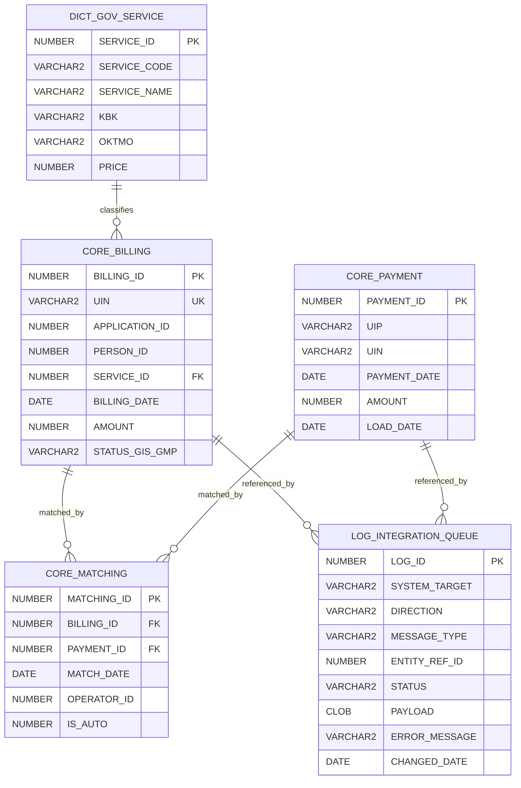
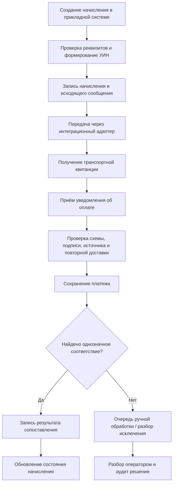

# Проектная модель интеграции начислений и платежей с ГИС ГМП

> **Статус: проектное предложение, не подтверждённая реализация ППО ID Docs.**
>
> Исходные DDL, XML и JSON ниже были предложены как вариант проектирования. Они не доказывают, что таблицы `CORE_BILLING`, `CORE_PAYMENT`, `CORE_MATCHING`, `LOG_INTEGRATION_QUEUE`, API, Сервисный концентратор или интеграции с ГИС ГМП, ЕПГУ и СМЭВ существуют в фактической инсталляции ППО ID Docs. Не включать эти объекты в физическую ERD и инвентаризацию действующей БД до подтверждения DDL, Oracle metadata и контрактами интеграции.

## 1. Назначение

Предлагаемая модель разделяет четыре области ответственности:

1. `DICT_GOV_SERVICE` — справочник государственных услуг и бюджетных реквизитов.
2. `CORE_BILLING` — начисление и его УИН.
3. `CORE_PAYMENT` — входящий факт платежа и его УИП.
4. `CORE_MATCHING` — результат сопоставления начисления и платежа.
5. `LOG_INTEGRATION_QUEUE` — техническое состояние обменных сообщений.

Предполагаемый сценарий: сформировать начисление, передать его во внешнюю систему, принять уведомление об оплате, сопоставить платеж с начислением и сохранить результат обработки. Это целевой сценарий проектирования, а не описание подтверждённого бизнес-процесса.

## 2. Предлагаемая логическая схема

Связи с `ARP_IND_APPLICATION` и `CORE_PERSONDATA` в исходном DDL заданы только комментариями: внешние ключи на эти таблицы не объявлены. Поэтому на схеме выше они намеренно не показаны как подтверждённые FK. Перед физической реализацией нужно установить реальные PK, FK, типы и владельцев этих сущностей.

## 3. Проверка исходного DDL: замечания и обязательные доработки

| Область | Что требует исправления или решения |
|---|---|
| Идентификаторы | Для PK не заданы генераторы значений (identity/sequence/trigger). Выбрать один согласованный механизм и правила миграции. |
| Связь с заявлением и лицом | `APPLICATION_ID` и `PERSON_ID` не имеют FK. Добавлять FK только после подтверждения таблиц, ключей и владельцев. |
| УИН и УИП | Проверить формат, длину, контрольные правила и уникальность по официальному контракту соответствующей версии ГИС ГМП. Комментарий «20 или 25 знаков» не является валидацией. |
| Суммы | Зафиксировать единицы измерения. В SQL сумма задана десятичным числом в рублях, а XML-пример использует целое число копеек. Не допускать неявного пересчёта. |
| Валюта | Определить валюту и масштаб суммы в модели; при необходимости хранить код валюты и исходное значение из сообщения. |
| Сопоставление | Определить допустимые кардинальности: один платёж на одно начисление, частичные/избыточные платежи, возвраты, повторные уведомления и отмены. Добавить уникальные ограничения только после фиксации этих правил. |
| Статусы | Ввести согласованный справочник/ограничения переходов статусов и хранить историю попыток. Значения `NEW/SENT/PAID/EXPIRED` сейчас приведены лишь в комментарии. |
| Очередь | Разделить бизнес-сообщение и технические попытки доставки; предусмотреть idempotency key, correlation ID, номер попытки, время следующей попытки, время создания/обновления и конечное состояние. |
| Ошибки | Разделить временные и постоянные ошибки, не сохранять секреты и избыточные персональные данные в тексте ошибки. |
| Транзакции | Определить атомарность записи входящего сообщения, платежа, результата сопоставления и подтверждения обработки. |
| Индексы | Предусмотреть индексы для поиска по УИН/УИП, статусу очереди, времени поступления и FK; окончательный набор — после профилирования запросов. |

### 3.1 Защита данных

В исходном примере `CORE_PAYMENT` содержит номер счёта и ИНН, а `LOG_INTEGRATION_QUEUE.PAYLOAD` — полный XML/JSON payload. Это создаёт риск избыточного хранения финансовых и персональных данных.

Рекомендуется:
- хранить только минимально необходимые атрибуты;
- не помещать полные платёжные реквизиты, документы, токены, сертификаты и секреты в общие логи;
- определить маскирование/токенизацию идентификаторов и срок хранения;
- шифровать данные при передаче и хранении согласно утверждённой политике;
- разграничить доступ к бизнес-таблицам, payload и техническим журналам;
- журналировать доступ к чувствительным данным и административные действия;
- не использовать реальные ФИО, ИНН, номера документов или банковских счетов в тестовых примерах и публичной документации.

## 4. Контракты обмена: только эскизы

### 4.1 Исходящее начисление

Предложенный XML с элементом `ExportChargeRequest` — иллюстративный эскиз. Его нельзя считать схемой СМЭВ 3 или ГИС ГМП. До реализации нужны официальные XSD/WSDL, версия сервиса, namespace, правила подписи, транспортный профиль, обязательность полей и тестовые примеры от оператора.

Отдельно проверить:
- единицы суммы и формат даты/времени;
- допустимые идентификаторы плательщика;
- соответствие УИН и SupplierBillID контракту;
- правила формирования КБК, ОКТМО, статуса и назначения платежа;
- требования к электронной подписи и квитанциям.

### 4.2 Входящее уведомление об оплате

Предложенный JSON — внутренний пример сообщения от гипотетического Сервисного концентратора, а не подтверждённый контракт ППО ID Docs. Поля `targetApplicationId`, `autoMatchRequired` и `paymentData` требуют формального определения источника, доверенной зоны и правил валидации.

Рекомендуемый минимальный envelope для дальнейшей спецификации: уникальный идентификатор сообщения, система-источник, время получения, версия схемы, идентификатор корреляции и ссылка на типизированное тело сообщения. Само тело следует проектировать по официальному внешнему контракту, а не по приведённому примеру.

## 5. Предлагаемый поток обработки

Диаграмма отражает предлагаемую целевую логику. Она не подтверждает наличие соответствующих компонентов или текущего обмена в ППО ID Docs.

## 6. Что необходимо получить для перевода проекта в подтверждённую архитектуру

1. Официальные спецификации и версии контрактов ГИС ГМП/СМЭВ/ЕПГУ, если эти интеграции действительно входят в контур.
2. Документ, подтверждающий роль и границы «Сервисного концентратора».
3. DDL или выгрузку Oracle metadata для реально существующих таблиц начислений, платежей и очередей.
4. PK/FK, индексы, триггеры, sequence/identity и владельцев объектов.
5. Описание бизнес-правил квитирования, частичных оплат, возвратов, отмен и повторных сообщений.
6. Политику хранения, маскирования и аудита персональных/платёжных данных.
7. Неперсонализированные примеры реальных сообщений и транспортных квитанций.

## 7. Итоговый статус

| Элемент | Статус |
|---|---|
| Идея раздельных сущностей начисления, платежа, сопоставления и интеграционной очереди | Проектное предложение |
| Имена таблиц и их поля из предоставленного DDL | Предложенная схема, не подтверждена физической БД |
| XML для исходящего начисления | Иллюстративный пример, XSD не проверена |
| JSON уведомления об оплате | Иллюстративный внутренний контракт |
| Интеграция с СМЭВ 3, ЕПГУ, ГИС ГМП через Сервисный концентратор | Требует документального подтверждения |
| Связи с `ARP_IND_APPLICATION` и `CORE_PERSONDATA` | Указаны комментариями, FK отсутствуют |

**Правило публикации:** до получения первичных артефактов этот материал размещается только в разделе проектных предложений. Он не должен увеличивать подтверждённый перечень таблиц, интеграций, API или компонентов ППО ID Docs.
